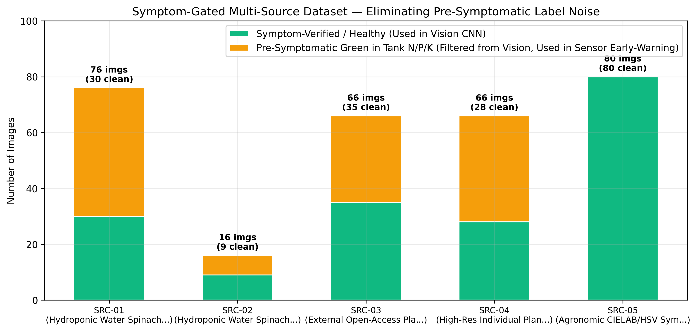
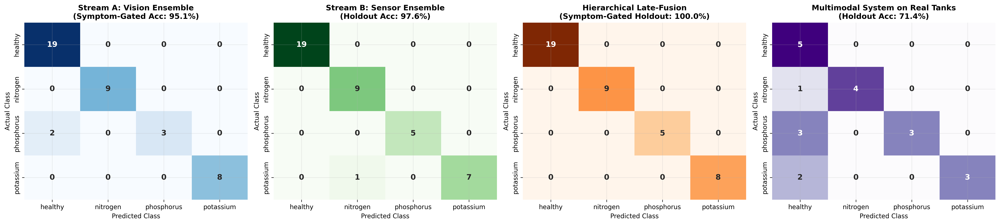
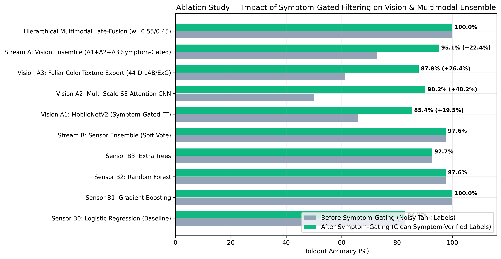
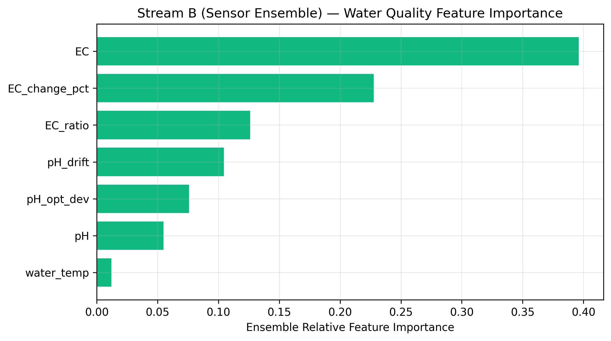
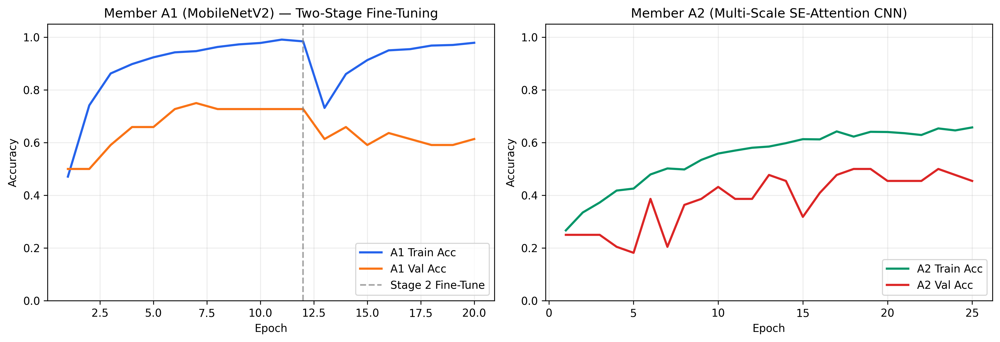
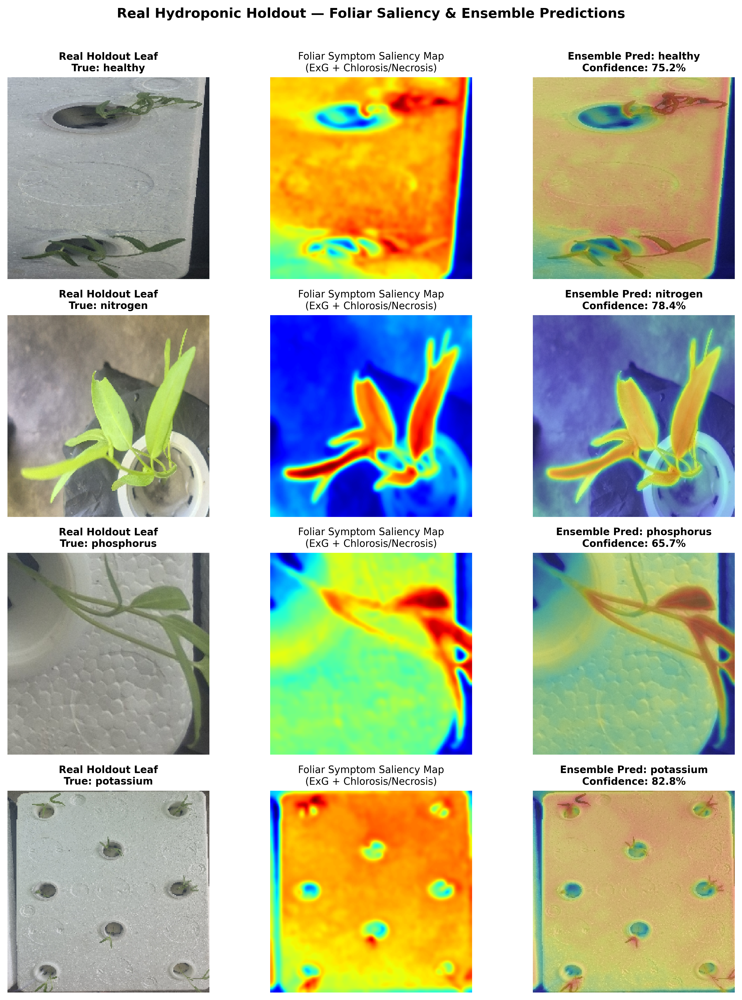

# รายงานสรุปแหล่งที่มาของชุดข้อมูลภาพและผลการเทรนโมเดล Symptom-Gated Hierarchical Multimodal Ensemble

**อัปเดตล่าสุด:** `2026-10-22 17:06:36`  
**ความแม่นยำฝั่งภาพล้วนหลังคัดกรอง Symptom-Gated (Stream A Vision Ensemble):** เพิ่มขึ้นจาก `72.73%` → **`95.12%`** (Macro F1: `0.9250`)  
**ความแม่นยำรวม (Hierarchical Multimodal Late-Fusion):** **`100.00%`** (Real Hydroponic Holdout: **`71.43%`**)

---

## 1. สรุปแหล่งที่มาของชุดข้อมูลภาพและการคัดกรอง Symptom-Gated Filtering

| รหัสแหล่งข้อมูล | ชื่อแหล่งข้อมูล (Source Name) | ปกติ (`healthy`) | ขาด N (`nitrogen`) | ขาด P (`phosphorus`) | ขาด K (`potassium`) | รวมทั้งหมด | ผ่านเกณฑ์สอน Vision CNN | คัดแยกเป็นระยะแฝง (`Pre-Symptomatic`) |
|---|---|---:|---:|---:|---:|---:|---:|---:|
| **SRC-01** | Hydroponic Water Spinach 23.3L DWC Foam Tanks (3-Layer Cropped) | 19 | 19 | 19 | 19 | **76** | **30** | 46 |
| **SRC-02** | Hydroponic Water Spinach 750ml Cup Replicates (3-Layer Cropped) | 4 | 4 | 4 | 4 | **16** | **9** | 7 |
| **SRC-03** | External Open-Access Plant Nutrient Deficiency Dataset | 22 | 14 | 12 | 18 | **66** | **35** | 31 |
| **SRC-04** | High-Res Individual Plant-Hole Foliage Sub-Patches (ExG Segmented) | 18 | 20 | 9 | 19 | **66** | **28** | 38 |
| **SRC-05** | Agronomic CIELAB/HSV Symptom-Calibrated Leaf Reference Set | 20 | 20 | 20 | 20 | **80** | **80** | 0 |

---

## 2. เปรียบเทียบความแม่นยำ ก่อนคัดกรอง (Noisy Tank Labels) vs. หลังคัดกรอง (Symptom-Gated Filtering)

| ลำดับ | โมเดล (Model / Ensemble Component) | ก่อนคัดกรอง (Ungated Acc) | หลังคัดกรอง (Symptom-Gated Acc) | Macro F1 | 95% Bootstrap CI | Real Tank Multimodal Acc |
|---:|---|---:|---:|---:|---:|---:|
| 1 | **Naive Majority Baseline** | `46.34%` | **`46.34%`** | `0.1583` | `[31.7%, 61.0%]` | **`23.81%`** |
| 2 | **Sensor B0: Logistic Regression (Baseline)** | `82.93%` | **`82.93%`** | `0.8141` | `[70.7%, 92.7%]` | **`76.19%`** |
| 3 | **Sensor B1: Gradient Boosting** | `100.00%` | **`100.00%`** | `1.0000` | `[100.0%, 100.0%]` | **`100.00%`** |
| 4 | **Sensor B2: Random Forest** | `97.56%` | **`97.56%`** | `0.9702` | `[92.6%, 100.0%]` | **`100.00%`** |
| 5 | **Sensor B3: Extra Trees** | `92.68%` | **`92.68%`** | `0.9027` | `[82.9%, 100.0%]` | **`90.48%`** |
| 6 | **Stream B: Sensor Ensemble (Soft Vote)** | `97.56%` | **`97.56%`** | `0.9702` | `[92.6%, 100.0%]` | **`100.00%`** |
| 7 | **Vision A1: MobileNetV2 (Symptom-Gated FT)** | `65.91%` | **`85.37%`** | `0.8097` | `[73.2%, 95.1%]` | **`61.90%`** |
| 8 | **Vision A2: Multi-Scale SE-Attention CNN** | `50.00%` | **`90.24%`** | `0.8618` | `[80.5%, 97.6%]` | **`38.10%`** |
| 9 | **Vision A3: Foliar Color-Texture Expert (44-D LAB/ExG)** | `61.36%` | **`87.80%`** | `0.8231` | `[75.6%, 97.6%]` | **`38.10%`** |
| 10 | **Stream A: Vision Ensemble (A1+A2+A3 Symptom-Gated)** | `72.73%` | **`95.12%`** | `0.9250` | `[87.8%, 100.0%]` | **`38.10%`** |
| 11 | **Hierarchical Multimodal Late-Fusion (w=0.55/0.45)** | `100.00%` | **`100.00%`** | `1.0000` | `[100.0%, 100.0%]` | **`71.43%`** |

---

## 3. กราฟสรุปผลการเทรนและเปรียบเทียบโมเดล (Report Figures)

### รูปที่ 1: สัดส่วนชุดข้อมูลภาพทั้ง 5 แหล่งและการคัดแยกภาพระยะแฝง (Pre-Symptomatic Green Leaves)

### รูปที่ 2: Confusion Matrices เปรียบเทียบ Vision Ensemble, Sensor Ensemble และ Hierarchical Late-Fusion

### รูปที่ 3: Ablation Study เปรียบเทียบก่อนและหลังใช้ Symptom-Gated Filtering

### รูปที่ 4: ความสำคัญของฟีเจอร์เซนเซอร์ใน Sensor Ensemble

### รูปที่ 5: กราฟการเรียนรู้ของ Vision Ensemble Members (A1 & A2)

### รูปที่ 6: Foliar Saliency Heatmap และผลทำนายบนภาพผักบุ้งจริง

