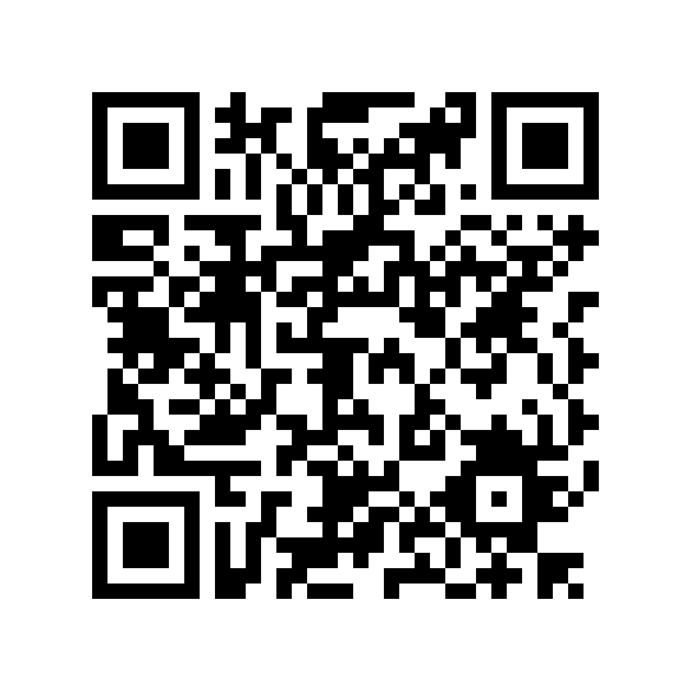

# Academic Research Poster QR Code & Asset Downloads

> **Project:** A.E.G.I.S. (Autonomous Hydroponics NPK Care System)  
> **Associated Reference:** [REFERENCES.md](REFERENCES.md)  
> **Standard:** APA 7th Edition (American Psychological Association)

---

## Academic Research Poster QR Code

  
   
  <em>Scan with any mobile camera or QR reader to view this reference list and open-source project artifacts directly.</em>
   
  <strong>Target URL:</strong> <code>https://github.com/nottyzez/A.E.G.I.S-Ai/blob/main/REFERENCES.md</code>

### High-Resolution QR Asset Downloads
* **High-Resolution Raster (PNG):** [`docs/assets/references_qr.png`](docs/assets/references_qr.png) (1440 × 1440 px, 300+ DPI print-ready)
* **Scalable Vector Graphic (SVG):** [`docs/assets/references_qr.svg`](docs/assets/references_qr.svg) (Lossless vector for professional poster printing)

---

## Academic Poster Sizing & Placement Guidance

For displaying this QR code on an academic conference poster (e.g., standard ANSI or ISO A0 / A1 sizes in Canva, PowerPoint, or Adobe Illustrator):

### 1. Recommended Print Dimensions
* **Standard Conference Presentation (Viewing distance 1.0 m / 3.3 ft):**  
  Printed size: **35 mm × 35 mm** (approx. 1.4 in × 1.4 in).
* **Walk-by Poster Session (Viewing distance 1.5 – 2.0 m / 5.0 – 6.5 ft):**  
  Printed size: **50 mm × 50 mm** to **60 mm × 60 mm** (approx. 2.0 in – 2.4 in).
* **Minimum Absolute Print Size:**  
  Do not print smaller than **25 mm × 25 mm** (1.0 in × 1.0 in) to ensure reliable optical scanning on mobile lenses without macro refocus delay.

### 2. Quiet Zone Margin
* The QR code requires a **quiet zone** (blank unprinted border) of at least **4 modules** (approximately 4–5 mm) on all four sides.
* The pre-generated PNG and SVG assets already embed this 4-module quiet zone. Do not crop the white margins when placing into poster authoring software (e.g., Canva, PowerPoint, InDesign, Illustrator).

### 3. Print Resolution & Color Contrast
* **Vector Preferred:** Use the vector SVG asset (`references_qr.svg`) for maximum sharpness at any scale without rasterization artifacts.
* **Raster Minimum:** If using the PNG asset (`references_qr.png`), ensure it prints at **300 DPI** or higher. At 1440 × 1440 px, the provided PNG can print up to 4.8 × 4.8 inches at 300 DPI with pristine edge fidelity.
* **Contrast:** Maintain solid black modules (`#000000`) on a crisp white background (`#FFFFFF`). Avoid placing on textured or dark poster backgrounds without a solid white backing card.
* **Lamination / Finish:** Prefer matte or satin lamination on poster boards over high-gloss to eliminate reflective glare from overhead exhibition spotlights.

### 4. Poster Placement & Call-to-Action (CTA)
* **Location:** Place the QR code in the **bottom-right corner** of the poster or adjacent to the **References / Acknowledgments** section.
* **Mounting Height:** Position between **1.2 m and 1.6 m** (47 in – 63 in) above floor level when the poster is pinned to the display easel, corresponding to typical adult chest/eye level.
* **Accompanying CTA:** Always include a legible title or caption beneath the code, such as:
  > *"Scan for Full Literature References (APA 7th) & Open-Source Code Repository"*
