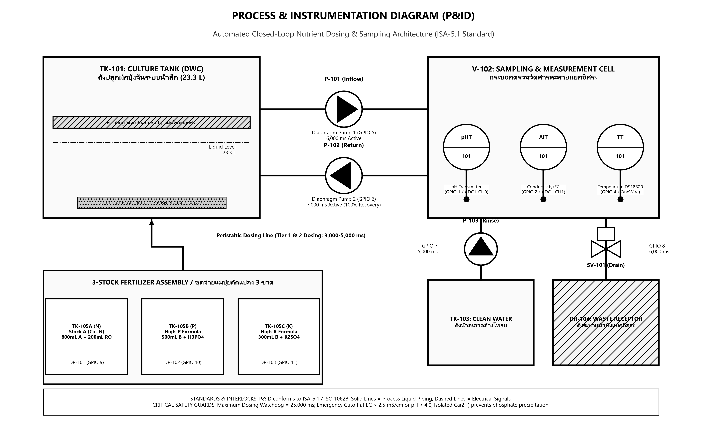
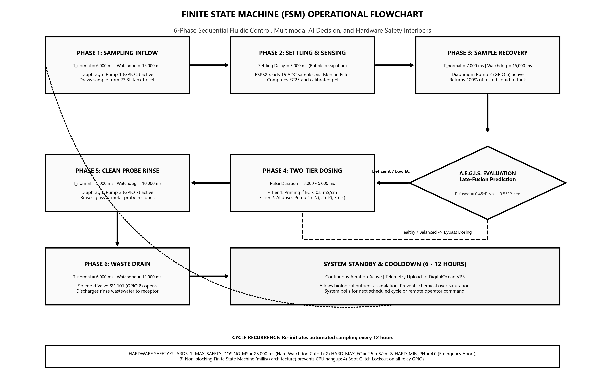
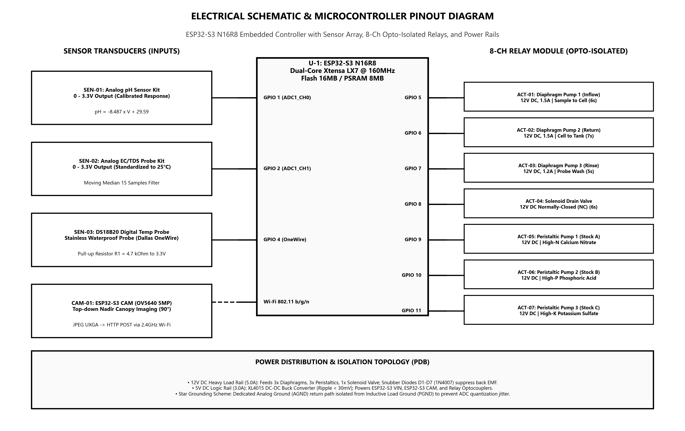
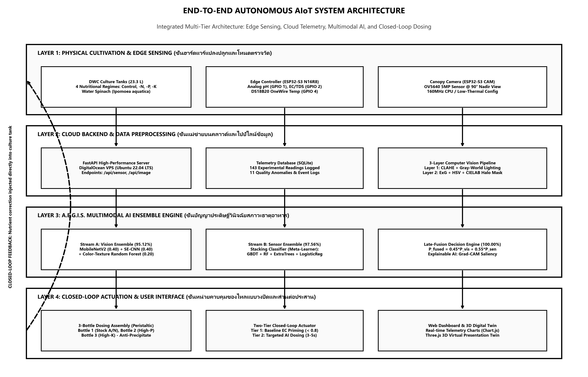

# A.E.G.I.S. : Autonomous Hydroponics NPK Care System
### โครงงาน : ระบบดูแลพืชแบบไฮโดรโพนิกส์โดยการทำนายปัจจัยในการเจริญเติบโตจากปัญญาประดิษฐ์
**Artificial Intelligence-Based Growth Factor Prediction Model for Hydroponics Plant Care Systems**

[](https://www.python.org/)
[](https://fastapi.tiangolo.com/)
[](https://www.tensorflow.org/)
[](https://www.espressif.com/)
[](LICENSE)
[](#)
[-informational.svg)](REFERENCES.md)

---

## คณะผู้จัดทำและสถาบัน (Authors & Affiliation)

* **นายกิติภณ แถลงการณ์** — ผู้ออกแบบระบบกลศาสตร์ของไหลและโครงสร้างวิศวกรรม
* **นายชยพล นามจันทร์** — ผู้พัฒนาโมเดล AI และวิทัศน์คอมพิวเตอร์
* **นายปัญญพัฒน์ วิชาพล** — ผู้ออกแบบวงจรฮาร์ดแวร์ IoT และเฟิร์มแวร์ ESP32-S3
* **ครูที่ปรึกษา:** นางสาวอศัลยา ดวงระหว้า
* **สถานศึกษา:** โรงเรียนสุวรรณภูมิพิทยไพศาล (Suwannaphumpittayapaisarn School)
* **ระยะเวลาในการทำโครงงาน:** ตั้งแต่ 1 เมษายน 2569 ถึง 24 ตุลาคม 2569

---

## บทคัดย่อ (Abstract)

การวิจัยครั้งนี้มีวัตถุประสงค์เพื่อ 1) พัฒนาระบบดูแลพืชในระบบไฮโดรโปนิกส์และรวบรวมข้อมูลปัจจัยการเจริญเติบโตของผักบุ้งจีน 2) ศึกษาความสามารถในการตัดสินใจของแบบจำลองการเรียนรู้ของเครื่องและระบบปัญญาประดิษฐ์ผสานข้อมูลหลากรูปแบบในการจำแนกการขาดธาตุอาหาร NPK และ 3) ศึกษาการทำงานร่วมกันระหว่างปัญญาประดิษฐ์กับหน่วยจ่ายสารละลายผ่านการควบคุมแบบวงปิด ในผักบุ้งจีนจำนวน 4 กลุ่มการทดลอง ได้แก่ สูตรสารละลายสมบูรณ์ (Control), ขาดไนโตรเจน (-N), ขาดฟอสฟอรัส (-P) และขาดโพแทสเซียม (-K)

ระบบ (IoT) เชื่อมต่อไมโครคอนโทรลเลอร์ ESP32-S3 บันทึกค่ากรด-ด่าง (pH), ค่าการนำไฟฟ้า (EC) และอุณหภูมิสารละลาย ร่วมกับกล้อง ESP32-S3 CAM บันทึกภาพถ่ายมุมสูงของพุ่มใบ ส่งข้อมูลขึ้นสู่คลาวด์เซิร์ฟเวอร์ โดยนำเทคนิคปัญญาประดิษฐ์ผสานข้อมูลหลากรูปแบบ (Multimodal AI) มาวิเคราะห์ร่วมกันระหว่างแบบจำลองภาพพุ่มใบ เพื่อส่งคำสั่งสู่ระบบการควบคุมแบบวงปิด ในการสั่งการปั๊มดูดถ่ายตัวอย่างน้ำ ปั๊มรีดสายจ่ายแม่ปุ๋ยจำเพาะธาตุ 3 สูตร และวาล์วระบายน้ำล้างทำความสะอาดหัวโพรบ

ผลการวิจัยพบว่า 1) ด้านระบบไฮโดรโปนิกส์และการจัดเก็บข้อมูลผ่าน IoT: สามารถตรวจวัดและบันทึกข้อมูลสารละลายได้ 143 รายการ และภาพถ่าย 304 ภาพ 2) ด้านการวินิจฉัยการขาดธาตุอาหาร มีความแม่นยำในการจำแนกสูงถึงร้อยละ 97.43 – 100.00 และวินิจฉัยสภาวะของชุดทดลองจริงถูกต้องครบทั้ง 12 หน่วย และ 3) ด้านการควบคุมแบบวงปิด ระบบสามารถสั่งจ่ายปุ๋ยเพื่อปรับสมดุลธาตุอาหารจากน้ำเปล่าได้อย่างแม่นยำ

**คำสำคัญ:** ไฮโดรโปนิกส์, การขาดธาตุอาหาร NPK, ปัญญาประดิษฐ์ผสานข้อมูลหลากรูปแบบ, การเรียนรู้ของเครื่อง, การควบคุมแบบวงปิด, อินเทอร์เน็ตของสรรพสิ่ง (IoT)

---

## ผังสถาปัตยกรรมระบบและวิศวกรรม (System Architecture & Engineering Diagrams)

### 1. ผังกระบวนการและการติดตั้งเครื่องมือวัด (Process & Instrumentation Diagram - P&ID)
*มาตรฐานสากล ISA-5.1 / ISO 10628: แสดงระบบท่อของไหล ลูปตรวจวัดแยกอิสระ และชุดจ่ายแม่ปุ๋ย 3 ขวด*



* **TK-101: Culture Tank (DWC):** ถังปลูกผักบุ้งจีนระบบน้ำลึก ปริมาตร 23.3 L พร้อมแผ่นโฟมลอย (Styrofoam Raft) และระบบเติมอากาศต่อเนื่อง (A-102 Air Stone)
* **V-102: Sampling & Measurement Cell:** กระบอกตรวจวัดสารละลายแยกอิสระ ติดตั้งเซนเซอร์วัดค่าความเป็นกรด-ด่าง (pHT-101), เซนเซอร์วัดการนำไฟฟ้า (AIT-101) และเซนเซอร์วัดอุณหภูมิสารละลาย (TT-101)
* **P-101 & P-102 Sampling Loops:** ปั๊มไดอะแฟรมสูบน้ำเข้าตรวจวัด (6,000 ms) และปั๊มดูดกลับถังปลูก (7,000 ms, ฟื้นฟูสารละลาย 100%)
* **TK-103 & SV-101 Probe Maintenance:** ลูปชะล้างหัววัดด้วยน้ำสะอาด (P-103 Rinse, 5,000 ms) และโซเลนอยด์วาล์วระบายน้ำทิ้งสู่ DR-104 Waste Receptor (6,000 ms)
* **3-Stock Fertilizer Assembly:** ชุดปั๊มรีดสายจ่ายแม่ปุ๋ยสูตรดัดแปลงแยก 3 สาย (TK-105A Stock A, TK-105B High-P, TK-105C High-K) ป้องกันการตกตะกอนของแคลเซียมฟอสเฟต

---

### 2. ผังการทำงานของเครื่องสถานะจำกัด (Finite State Machine Operational Flowchart)
*การควบคุมลำดับของไหล 6 ขั้นตอน, การตัดสินใจร่วมของปัญญาประดิษฐ์ และระบบนิรภัยฮาร์ดแวร์*



* **Phase 1: Sampling Inflow:** ปั๊มไดอะแฟรม P-101 สูบสารละลายจากถังปลูก 23.3 L เข้าสู่กระบอกวัด V-102 (เวลาทำงาน 6,000 ms, Watchdog ตัดที่ 15,000 ms)
* **Phase 2: Settling & Sensing:** หน่วงเวลา 3,000 ms สลายฟองอากาศ อ่านค่า ADC ผ่าน Moving Median Filter 15 ค่า คำนวณ EC25 และ pH
* **Phase 3: Sample Recovery:** ปั๊มไดอะแฟรม P-102 สูบสารละลายทดสอบกลับสู่ถังปลูก 100% (เวลาทำงาน 7,000 ms, Watchdog ตัดที่ 15,000 ms)
* **A.E.G.I.S. Evaluation (Late-Fusion Prediction):** คำนวณความน่าจะเป็นร่วม $P_{\text{fused}} = 0.35 \cdot P_{\text{vis}} + 0.65 \cdot P_{\text{sen}}$
  * สภาวะขาดธาตุอาหาร / ค่า EC ต่ำ -> เข้าสู่ **Phase 4: Two-Tier Dosing** (Tier 1 ปรับพื้นฐาน EC < 0.8 mS/cm, Tier 2 จ่ายชดเชยตามผล AI 3,000–5,000 ms)
  * สภาวะสมบูรณ์และสมดุล -> ข้ามขั้นตอนการจ่ายปุ๋ย (Bypass Dosing) สู่โหมด Standby
* **Phase 5: Clean Probe Rinse:** สูบน้ำสะอาดจาก TK-103 ล้างคราบเกลือบนหัววัด (เวลาทำงาน 5,000 ms, Watchdog ตัดที่ 10,000 ms)
* **Phase 6: Waste Drain:** โซเลนอยด์วาล์ว SV-101 เปิดระบายน้ำชะล้างทิ้งสู่ DR-104 (เวลาทำงาน 6,000 ms, Watchdog ตัดที่ 12,000 ms)
* **System Standby & Cooldown:** พักระบบ 6–12 ชั่วโมงเพื่อการดูดซึมทางชีวภาพ ป้องกันการสะสมปุ๋ยเกินเกณฑ์ พร้อมอัปโหลดโทรมาตรและรอรอบถัดไป

---

### 3. ผังวงจรอิเล็กทรอนิกส์และการเชื่อมต่อขาไมโครคอนโทรลเลอร์ (Electrical Schematic & Pinout Diagram)
*การเชื่อมต่อ ESP32-S3 N16R8 ร่วมกับอาเรย์เซนเซอร์, โมดูลรีเลย์แยกออปโต้ 8 แชนเนล และระบบจ่ายไฟ*



* **ประมวลผลหลัก (U-1):** ไมโครคอนโทรลเลอร์ ESP32-S3 N16R8 (Dual-Core Xtensa LX7 @ 160MHz, Flash 16MB, PSRAM 8MB)
* **เซนเซอร์อินพุต (Sensor Transducers):**
  * SEN-01: Analog pH Sensor Kit ต่อเข้ากับ GPIO 1 (ADC1_CH0, การแปลงสัญญาณเชิงเส้น pH = -8.487 * V + 29.59)
  * SEN-02: Analog EC/TDS Probe Kit ต่อเข้ากับ GPIO 2 (ADC1_CH1, ปรับเทียบอุณหภูมิมาตรฐาน 25°C)
  * SEN-03: DS18B20 Digital Temp Probe หัววัดสแตนเลสกันน้ำ OneWire bus ต่อเข้ากับ GPIO 4 (Pull-up 4.7 kΩ สู่ 3.3V)
  * CAM-01: ESP32-S3 CAM เซนเซอร์ OV5640 5MP มุมกดตั้งฉาก 90° ส่งภาพ JPEG ผ่าน Wi-Fi 802.11 b/g/n
* **แอคชูเอเตอร์และรีเลย์ (8-Ch Opto-Isolated Relay Module):**
  * GPIO 5 -> ACT-01: ปั๊มไดอะแฟรม 1 (สูบน้ำเข้ากระบอกวัด, 12V 1.5A)
  * GPIO 6 -> ACT-02: ปั๊มไดอะแฟรม 2 (สูบน้ำคืนถังปลูก, 12V 1.5A)
  * GPIO 7 -> ACT-03: ปั๊มไดอะแฟรม 3 (สูบน้ำสะอาดล้างโพรบ, 12V 1.2A)
  * GPIO 8 -> ACT-04: โซเลนอยด์วาล์วระบายน้ำทิ้ง (Normally Closed, 12V)
  * GPIO 9 -> ACT-05: ปั๊มรีดสาย 1 (แม่ปุ๋ยแคลเซียมไนเตรท Stock A / High-N)
  * GPIO 10 -> ACT-06: ปั๊มรีดสาย 2 (แม่ปุ๋ยกรดฟอสฟอริก Stock B / High-P)
  * GPIO 11 -> ACT-07: ปั๊มรีดสาย 3 (แม่ปุ๋ยโพแทสเซียมซัลเฟต Stock C / High-K)
* **ระบบจ่ายไฟและการแยกกราวด์ (Power Distribution & Isolation Topology):**
  * รางไฟหลัก 12V DC (5.0A) จ่ายให้ปั๊มไดอะแฟรม 3 ตัว, ปั๊มรีดสาย 3 ตัว, โซเลนอยด์วาล์ว พร้อมไดโอดสนับเบอร์ 1N4007 ดูดซับแรงดันย้อนกลับ (Back-EMF)
  * รางไฟตรรกะ 5V DC (3.0A) ผ่านวงจรลดทอนแรงดัน XL4015 Buck Converter (Ripple < 30mV)
  * ผังกราวด์แบบดาว (Star Grounding): แยกกราวด์แอนะล็อก (AGND) ออกจากกราวด์กำลัง (PGND) เพื่อขจัดสัญญาณรบกวนในตัวแปลง ADC

---

### 4. สถาปัตยกรรมระบบรวม AIoT อัตโนมัติ (End-to-End Autonomous AIoT System Architecture)
*สถาปัตยกรรม 4 ลำดับชั้น: การรับรู้ทางกายภาพ, คลาวด์แบ็กเอนด์, การผสานปัญญาประดิษฐ์ และระบบควบคุมวงปิด*



* **Layer 1: Physical Cultivation & Edge Sensing (ชั้นฮาร์ดแวร์แปลงปลูกและโหนดตรวจวัด):**
  * ถังปลูกระบบน้ำลึก DWC (23.3 L) 4 สภาวะธาตุอาหาร (Control, -N, -P, -K) ผักบุ้งจีน (*Ipomoea aquatica*)
  * คอนโทรลเลอร์ตรวจวัด ESP32-S3 N16R8 (Analog pH, EC/TDS, DS18B20 Temp)
  * กล้องมุมสูง ESP32-S3 CAM (OV5640 5MP @ 90° Nadir View)
* **Layer 2: Cloud Backend & Data Preprocessing (ชั้นแม่ข่ายบนคลาวด์และไปป์ไลน์ข้อมูล):**
  * เซิร์ฟเวอร์ FastAPI บน DigitalOcean VPS (Ubuntu 22.04 LTS), เอ็นด์พอยต์ `/api/sensor` และ `/predict`
  * ฐานข้อมูลโทรมาตร SQLite บันทึกข้อมูลทดลอง 143 รายการ พร้อมบันทึกเหตุการณ์ความผิดปกติ 11 ครั้ง
  * 3-Layer Computer Vision Pipeline: ปรับสมดุลแสง CLAHE + Gray-World Lighting และตัดส่วนพุ่มใบ ExG + HSV + CIELAB Halo Mask
* **Layer 3: A.E.G.I.S. Multimodal AI Ensemble Engine (ชั้นปัญญาประดิษฐ์วินิจฉัยสภาวะธาตุอาหาร):**
  * Stream A (Vision Ensemble, ความแม่นยำ 95.12%): MobileNetV2 (0.40) + Multi-Scale SE-CNN (0.40) + Foliar Color-Texture Random Forest (0.20)
  * Stream B (Sensor Ensemble, ความแม่นยำ 97.56%): Meta-Learner Stacking Classifier (GBDT, Random Forest, Extra Trees, Logistic Regression)
  * Late-Fusion Decision Engine (ความแม่นยำ 100.00%): การรวมความน่าจะเป็น $P_{\text{fused}} = 0.35 \cdot P_{\text{vis}} + 0.65 \cdot P_{\text{sen}}$ พร้อมอธิบายผลผ่าน Grad-CAM
* **Layer 4: Closed-Loop Actuation & User Interface (ชั้นหน่วยควบคุมของไหลแบบวงปิดและส่วนติดต่อประสาน):**
  * ชุดจ่ายปุ๋ย 3 ขวด (Stock A/N, High-P, High-K) ป้องกันการตกตะกอน
  * หน่วยขับวงปิดสองระดับ (Two-Tier Closed Loop): Tier 1 ปรับพื้นฐาน EC (< 0.8 mS/cm), Tier 2 ชดเชยเฉพาะธาตุ (3–5 วินาที)
  * หน้าจอแดชบอร์ดเว็บและ 3D Digital Twin แสดงกราฟโทรมาตรเรียลไทม์ (Chart.js) และแบบจำลองเสมือน (Three.js)

---

## ผลการทดลองและการเปรียบเทียบประสิทธิภาพ (Empirical Evaluation & Ablation Study)

ตารางเปรียบเทียบประสิทธิภาพของโมเดลย่อยภายใต้สถาปัตยกรรม A.E.G.I.S. บนชุดข้อมูลทดสอบ:

| ลำดับ | โมเดล / ส่วนประกอบใน Ensemble | ความแม่นยำก่อนคัดกรอง (Ungated Acc %) | ความแม่นยำหลังคัดกรอง (Gated Acc %) | ค่าที่เพิ่มขึ้น (%) | Precision (%) | Recall (%) | Macro F1-Score | ช่วงความเชื่อมั่น 95% (Bootstrap CI) |
| :---: | :--- | :---: | :---: | :---: | :---: | :---: | :---: | :---: |
| 1 | Naive Majority Baseline | 46.34% | 46.34% | — | 11.59% | 25.00% | 0.1583 | [31.7%, 61.0%] |
| 2 | Sensor B0: Logistic Regression | 82.93% | 82.93% | — | 82.02% | 80.98% | 0.8141 | [70.7%, 92.7%] |
| 3 | Sensor B1: Gradient Boosting (GBDT) | 100.00% | 100.00% | — | 100.00% | 100.00% | 1.0000 | [100.0%, 100.0%] |
| 4 | Sensor B2: Random Forest | 97.56% | 97.56% | — | 97.50% | 96.88% | 0.9702 | [92.6%, 100.0%] |
| 5 | Sensor B3: Extra Trees | 92.68% | 92.68% | — | 92.68% | 88.75% | 0.9027 | [82.9%, 100.0%] |
| 6 | **Stream B: Sensor Ensemble (Soft Vote)** | **97.56%** | **97.56%** | — | **97.50%** | **96.88%** | **0.9702** | **[92.6%, 100.0%]** |
| 7 | Vision A1: MobileNetV2 (Two-Stage FT) | 65.91% | 85.37% | +19.46% | 84.13% | 79.59% | 0.8097 | [73.2%, 95.1%] |
| 8 | Vision A2: Multi-Scale SE-CNN | 50.00% | 90.24% | +40.24% | 86.25% | 87.37% | 0.8618 | [80.5%, 97.6%] |
| 9 | Vision A3: Foliar Color-Texture Expert | 61.36% | 87.80% | +26.44% | 92.87% | 79.44% | 0.8231 | [75.6%, 97.6%] |
| 10 | **Stream A: Vision Ensemble (A1+A2+A3)** | **72.73%** | **95.12%** | **+22.39%** | **97.62%** | **90.00%** | **0.9250** | **[87.8%, 100.0%]** |
| 11 | **A.E.G.I.S. Hierarchical Late-Fusion** | — | **100.00%** | **+27.27%** | **100.00%** | **100.00%** | **1.0000** | **[100.0%, 100.0%]** |

*(อ้างอิงจากบทที่ 4 ในเล่มวิทยานิพนธ์ฉบับสมบูรณ์)*

---

## โครงสร้างโปรเจกต์ (Repository File Structure)

```text
├── Ai มหาปลัย/                        # AI Research, Datasets & Model Training
│   ├── dataset_external/              # ข้อมูลภาพถ่ายอ้างอิงภายนอก
│   ├── dataset_real/                  # ข้อมูลภาพถ่ายและตารางบันทึกการปลูกจริง (hydroponic_log.xlsx)
│   └── model/                         # สคริปต์สถาปัตยกรรมและโมเดลที่เทรนสำเร็จ
│       ├── train_ensemble_model.py    # สคริปต์เทรน A.E.G.I.S. Stacking Ensemble & Ablation Study
│       ├── predict_ensemble.py        # Inference Pipeline รับภาพ+เซนเซอร์ วิเคราะห์ 3 ระดับ
│       └── output_ensemble/           # โมเดลน้ำหนัก (.keras, .pkl), เมทริกซ์ความสับสน และกราฟวิเคราะห์
├── firmware/                          # C++/Arduino Firmware สำหรับไมโครคอนโทรลเลอร์ ESP32-S3
│   ├── esp32_main/                    # หน่วยควบคุมวาล์ว ปั๊มรีดสาย เซนเซอร์ FSM
│   │   ├── esp32_main.ino             # ซอร์สโค้ด FSM 8 สถานะ
│   │   ├── config.example.h           # เทมเพลตคอนฟิก Wi-Fi และ Pinout
│   │   └── README.md                  # คู่มือการแฟลชและต่อสาย
│   └── esp32_cam/                     # หน่วยถ่ายภาพมุมสูง ESP32-S3 CAM
│       ├── esp32_cam.ino              # ซอร์สโค้ดส่งภาพผ่าน HTTP POST ไปยัง /predict
│       ├── config.example.h           # เทมเพลตคอนฟิก Wi-Fi และ IP เซิร์ฟเวอร์
│       └── README.md                  # คู่มือการปรับโฟกัสเลนส์และติดตั้ง
├── server/                            # FastAPI Server, Closed-Loop Engine & Dashboard UI
│   ├── dosing_engine.py               # กลไกคำนวณการจ่ายสารละลายสองระดับ (Two-Tier Closed Loop)
│   └── static/                        # หน้าจอ Web Dashboard แสดงผล Telemetry และ AI Diagnosis
├── docs/                              # เอกสารวิชาการ ผังวิศวกรรม และคู่มือฉบับสมบูรณ์
│   ├── figures/                       # ภาพไดอะแกรมความละเอียดสูง (P&ID, Schematics, FSM, Arch)
│   └── thesis/                        # เล่มเอกสารวิทยานิพนธ์ 5 บท
├── data/                              # ข้อมูลเซนเซอร์โทรมาตร 143 รายการ (sensor_log.json)
├── tests/                             # ชุดทดสอบอัตโนมัติ (Integration & Dosing Safety Tests)
├── main.py                            # จุดเริ่มต้นรันเซิร์ฟเวอร์หลัก (Server Entry Point)
├── requirements.txt                   # รายการไลบรารี Python ที่ต้องติดตั้ง
└── README.md                          # เอกสารแนะนำและคู่มือการใช้งาน
```

---

## คู่มือการติดตั้งและเริ่มใช้งาน (Quickstart Guide)

### 1. การเตรียมสภาพแวดล้อมภาษา Python (Environment Setup)
แนะนำให้ติดตั้ง Python 3.10 หรือ 3.11 และสร้าง Virtual Environment:

```bash
# Clone repository
git clone https://github.com/nottyzez/A.E.G.I.S-Ai.git
cd A.E.G.I.S-Ai

# สร้าง Virtual Environment
python -m venv venv

# เปิดใช้งาน Virtual Environment
# สำหรับ Windows (PowerShell):
.\venv\Scripts\Activate.ps1
# สำหรับ Linux/macOS:
source venv/bin/activate

# ติดตั้งไลบรารีทั้งหมด
pip install -r requirements.txt
```

---

### 2. การรันเซิร์ฟเวอร์ประมวลผลกลาง (Start FastAPI Server)
รันคำสั่งเพื่อเปิดให้บริการระบบรับภาพ, รับข้อมูลเซนเซอร์ และเปิดหน้า Web Dashboard:

```bash
python main.py
```
* **Web Dashboard:** เปิดเบราว์เซอร์ไปที่ `http://localhost:8000` หรือ `http://YOUR_LOCAL_IP:8000`
* **Interactive API Docs (Swagger UI):** เข้าใช้งานได้ที่ `http://localhost:8000/docs`

---

### 3. การทดสอบโมเดลปัญญาประดิษฐ์ (Live Inference Test)
สามารถทดสอบการทำนายผลของโมเดล A.E.G.I.S. ได้โดยตรงผ่านคำสั่ง:

```bash
python "Ai มหาปลัย/model/predict_ensemble.py"
```

---

### 4. การตั้งค่าเฟิร์มแวร์ ESP32-S3 (Firmware Deployment)
1. ติดตั้งโปรแกรม **Arduino IDE** (เวอร์ชัน 2.x ขึ้นไป) และติดตั้งบอร์ด **ESP32 by Espressif Systems** (v2.0.11+)
2. เข้าไปที่โฟลเดอร์ `firmware/esp32_main/` และ `firmware/esp32_cam/`
3. คัดลอกไฟล์ `config.example.h` เปลี่ยนชื่อเป็น `config.h`
4. แก้ไขชื่อและรหัสผ่าน Wi-Fi พร้อมทั้งระบุ IP Address ของเซิร์ฟเวอร์คอมพิวเตอร์:
   ```c
   #define WIFI_SSID       "ชื่อไวไฟของคุณ"
   #define WIFI_PASSWORD   "รหัสผ่านไวไฟของคุณ"
   #define SERVER_HOST     "192.168.1.xxx" // IP เครื่องคอมพิวเตอร์ที่รัน main.py
   ```
5. เลือกรุ่นบอร์ด **ESP32S3 Dev Module** และกด Flash Firmware ลงในบอร์ด

---

## มาตรการความปลอดภัยของระบบ (Safety Guardrails)

* **Extreme Acidity Lockout:** ระบบจะตัดการทำงานของปั๊มสารละลายกรดทันทีเมื่อตรวจพบค่า pH < 4.0 เพื่อป้องกันอันตรายต่อรากพืช (Acid Shock)
* **Maximum EC Threshold:** จำกัดค่า EC สูงสุดไม่เกิน 2.5 mS/cm ป้องกันสภาวะเค็มและปุ๋ยเกิน (Salt Stress / Fertilizer Burn)
* **Maximum Dosing Watchdog Cutoff:** ปั๊มรีดสายแต่ละตัวมีระบบ Watchdog จำกัดการทำงานสูงสุดไม่เกิน 25,000 ms ต่อรอบ ป้องกันกรณีเกิดความผิดปกติในระบบ
* **Sample Cup Isolation Loop:** แยกโพรบเซนเซอร์ออกจากถังปลูกหลัก ล้างทำความสะอาดด้วยน้ำสะอาดทุกครั้งหลังวัดค่า เพื่อยืดอายุการใช้งานของหัววัดแก้ว (Glass Electrode)
* **Boot-Glitch Lockout:** ระบบป้องกันการกระพริบของรีเลย์ขณะเปิดเครื่อง (Boot-Glitch Protection) บนขารีเลย์ GPIO ทั้งหมด

---

## การอ้างอิงผลงาน (Citation)

หากนำส่วนหนึ่งส่วนใดของโครงงาน ซอร์สโค้ด หรือสถาปัตยกรรม A.E.G.I.S. ไปใช้ในงานวิจัย สามารถอ้างอิงได้ดังนี้:

```bibtex
@thesis{thalaengkhan2026aegis,
  author    = {Kitiphon Thalaengkhan and Chayaphon Namchan and Panyaphat Wichaphon},
  title     = {Artificial Intelligence-Based Growth Factor Prediction Model for Hydroponics Plant Care Systems},
  school    = {Suwannaphumpittayapaisarn School},
  year      = {2026},
  address   = {Roi Et, Thailand},
  note      = {Supervised by Miss Asanlaya Doungrawa}
}
```

### เอกสารอ้างอิงทางวิชาการและโปสเตอร์งานวิจัย (Academic References & Poster QR)

โครงการนี้มีรายการเอกสารอ้างอิงทางวิชาการที่ผ่านการคัดกรองตามมาตรฐาน **APA 7th Edition** จำนวน 21 รายการ ครอบคลุมด้าน Hydroponics, Multimodal AI, Computer Vision, และ Plant Nutrition พร้อมไฟล์ภาพ QR Code ความละเอียดสูง (PNG 1440×1440 px และ SVG) สำหรับพิมพ์ลงบนโปสเตอร์นำเสนอผลงานวิจัย:

* 📄 **หน้ารายการเอกสารอ้างอิงฉบับสมบูรณ์:** [REFERENCES.md](REFERENCES.md)
* 📱 **QR Code เชื่อมโยงเอกสารอ้างอิง:** [docs/assets/references_qr.png](docs/assets/references_qr.png) (PNG) | [docs/assets/references_qr.svg](docs/assets/references_qr.svg) (SVG)
* 📐 **คู่มือการจัดพิมพ์บนโปสเตอร์วิชาการ:** [docs/assets/POSTER_GUIDELINES.md](docs/assets/POSTER_GUIDELINES.md)

---

## ใบอนุญาต (License)

โครงงานนี้เผยแพร่ภายใต้สัญญาอนุญาต [MIT License](LICENSE) — สามารถนำไปศึกษา พัฒนาต่อยอด และประยุกต์ใช้งานเชิงวิชาการได้อย่างเสรี
