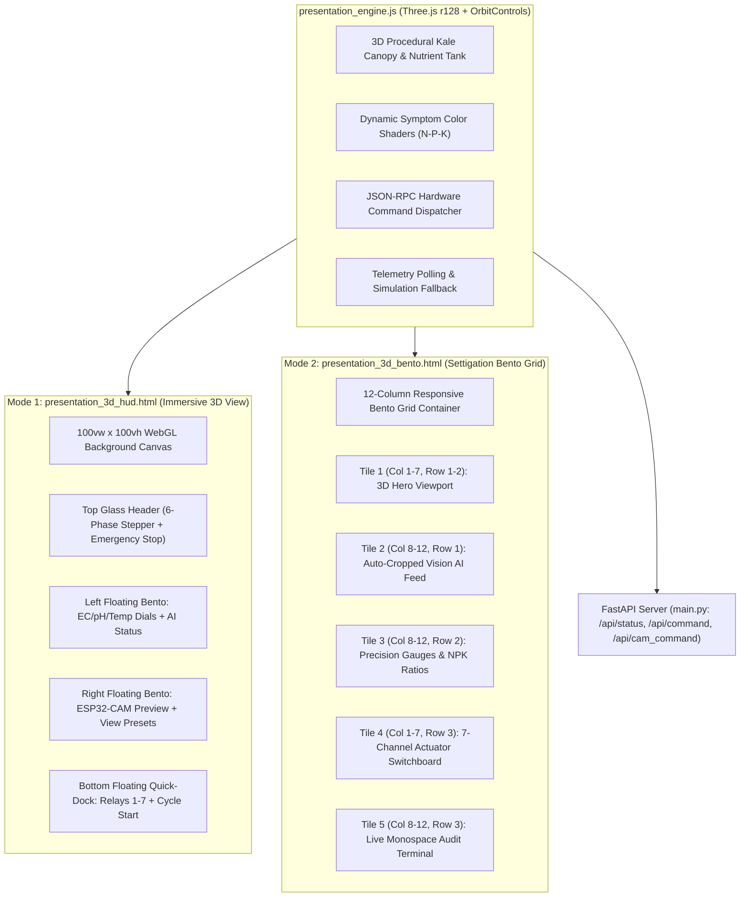

# A.E.G.I.S. AI Smart Hydroponics — 3D Presentation & Control Dashboard Roadmap

**Project:** Autonomous Hydroponic Crop Care & Single-Box Fertigation Testbench  
**Team:** A.E.G.I.S. Team (`aegis.team@spp.ac.th`)  
**Status:** Architecture Blueprint & Implementation Roadmap (Archived in Local Branch `backup/presentation-3d`)  
**Target Reference:** Settigation Design System (`@settigation` on TikTok)  

---

## 1. Executive Summary & Design Rationale

During competitive thesis defenses, academic demonstrations, and live project presentations, presenters need to convey two critical dimensions simultaneously:
1. **Intelligent Edge Diagnostics**: Top-down computer vision foliage inspection and multimodal late-fusion symptom classification (Healthy, -N, -P, -K).
2. **Precision Mechanical Actuation**: Closed-loop dosing of 3 fertilizer formulas (Peristaltic Pumps 1-3), automated sampling fluidics (Diaphragms 1-3 for Inflow, Return, Clean Rinse), and Solenoid drainage.

This document establishes the complete architectural specification for two presentation interfaces designed to elevate audience engagement without modifying legacy operational tools (`dashboard.html` and `presentation_controller.html`).

---

## 2. Dual Presentation Paradigms (System Architectures)



---

## 3. UI/UX Wireframes

### Mode 1: Immersive 3D HUD View (`presentation_3d_hud.html`)
```text
+---------------------------------------------------------------------------------+
| [CPU Icon] HydroSync 3D HUD  [ 1:INFLOW -> 2:SENSE -> 3:AI -> 4:DOSE -> ... ]  [STOP] |
|---------------------------------------------------------------------------------|
|                                                                                 |
|  [LEFT FLOATING BENTO]                                 [RIGHT FLOATING BENTO]   |
|  +--------------------+                               +---------------------+   |
|  | EC: 1.85 mS/cm     |       [ 3D DIGITAL TWIN ]     | ESP32-CAM Viewfinder|   |
|  | pH: 6.20           |     Procedural Kale Canopy    | [Snap Image Button] |   |
|  | Temp: 26.5 C       |      Fluidics Reservoir       | View: [Top|Side|Iso]|   |
|  | AI: Control 96.5%  |      Bubbling Aeration        | Morph: [N | P | K]  |   |
|  +--------------------+                               +---------------------+   |
|                                                                                 |
|                      [BOTTOM FLOATING ACTUATOR QUICK-DOCK]                      |
|  +---------------------------------------------------------------------------+  |
|  | [START FULL AI CYCLE] | P1(N) | P2(P) | P3(K) | IN | RET | RINSE | DRAIN  |  |
|  +---------------------------------------------------------------------------+  |
+---------------------------------------------------------------------------------+
```

### Mode 2: Settigation Modular Bento Grid (`presentation_3d_bento.html`)
```text
+---------------------------------------------------------------------------------+
| [Layout Icon] HydroSync Settigation Bento [Steppers: 1 2 3 4 5 6] [Online] [STOP] |
|---------------------------------------------------------------------------------|
|                                           |                                     |
|  TILE 1: 3D HERO VIEWPORT (Col 1-7)       |  TILE 2: TOP-DOWN VISION (Col 8-12) |
|  +-------------------------------------+  |  +-------------------------------+  |
|  | Interactive Three.js WebGL Canvas   |  |  | Latest Auto-Cropped Plant     |  |
|  | Left Click: Rotate, Scroll: Zoom    |  |  | AI Class: Control (96.5%)     |  |
|  | Symptom: [Ctrl] [-N] [-P] [-K]      |  |  +-------------------------------+  |
|  +-------------------------------------+  |                                     |
|                                           |  TILE 3: TELEMETRY & RATIOS (Col 8-12)
|                                           |  +-------------------------------+  |
|                                           |  | EC: 1.85 | pH: 6.20 | 26.5 C  |  |
|                                           |  | NPK Ratio Bar: 33% 33% 34%    |  |
|                                           |  +-------------------------------+  |
|-------------------------------------------+-------------------------------------|
|  TILE 4: ACTUATOR SWITCHBOARD (Col 1-7)   |  TILE 5: AUDIT TERMINAL (Col 8-12)  |
|  +-------------------------------------+  |  +-------------------------------+  |
|  | [P1 N] [P2 P] [P3 K] [In] [Out]...  |  |  | [22:15:01] System Polling OK  |  |
|  | [START FULL AI CYCLE BUTTON]        |  |  | [22:15:02] Relay #1 Dispatched|  |
|  +-------------------------------------+  |  +-------------------------------+  |
+---------------------------------------------------------------------------------+
```

---

## 4. 3D Digital Twin Mathematical & Shader Specifications

### 4.1 Leaf Blade Curvature Formulation
To simulate the curled margins of *Brassica oleracea* (Curly Kale), leaf geometry is computed procedurally over a normalized grid $(u, v) \in [-1, 1]$:
$$z(u, v) = \sin(3u) \cdot 0.18 - 0.08v^2 + \cos(6v) \cdot \sin(5u) \cdot 0.08$$
where:
- $\sin(3u) \cdot 0.18$: Central longitudinal leaf cupping along the main midrib.
- $-0.08v^2$: Parabolic drooping from stem to leaf tip.
- $\cos(6v)\sin(5u) \cdot 0.08$: High-frequency ruffled margins characteristic of kale foliage.

### 4.2 Dynamic Deficiency Symptom Color Shaders
The digital twin dynamically reflects both AI classifications and user interactive previews using targeted color shifts:

| Nutrient Class | Primary Leaf Hex | Highlight Hex | Margin / Petiole Hex | Morphological Manifestation |
|---|---|---|---|---|
| **Control (Healthy)** | `#10b981` | `#34d399` | `#059669` / `#047857` | Uniform deep emerald green, high turgor pressure |
| **Nitrogen Deficiency (`-N`)** | `#eab308` | `#fef08a` | `#ca8a04` / `#a16207` | General chlorosis, yellowing starting from oldest basal leaves |
| **Phosphorus Deficiency (`-P`)** | `#3b82f6` | `#8b5cf6` | `#6d28d9` / `#4c1d95` | Anthocyanin accumulation, dark bluish-green blade with violet/purple leaf margins |
| **Potassium Deficiency (`-K`)** | `#15803d` | `#f97316` | `#b45309` / `#166534` | Marginal chlorosis progressing to edge necrosis and scorched tip curling |

---

## 5. 7-Channel Hardware Actuator & Relay Matrix

Both dashboards communicate with the ESP32-S3 mainboard via `/api/command` with payload `{"command": "MANUAL_RELAY", "relay": int, "duration_ms": int}`:

| Actuator ID | Pin / Channel | Hardware Component | Nominal Function | Typical Pulse Duration |
|---|---|---|---|---|
| **`ACT-01`** | Relay 1 (GPIO 5) | Peristaltic Pump 1 | Doses Formula A (Nitrogen-Rich Stock) | 1,000 – 5,000 ms |
| **`ACT-02`** | Relay 2 (GPIO 6) | Peristaltic Pump 2 | Doses Formula B (Phosphorus-Rich Stock) | 1,000 – 5,000 ms |
| **`ACT-03`** | Relay 3 (GPIO 7) | Peristaltic Pump 3 | Doses Formula C (Potassium-Rich Stock) | 1,000 – 5,000 ms |
| **`ACT-04`** | Relay 4 (GPIO 8) | Diaphragm Pump 1 | Inflow: draws solution from hydroponic reservoir into measurement cell | 5,000 – 15,000 ms |
| **`ACT-05`** | Relay 5 (GPIO 9) | Diaphragm Pump 2 | Return: pumps solution back from cell to reservoir after testing | 5,000 – 15,000 ms |
| **`ACT-06`** | Relay 6 (GPIO 10) | Diaphragm Pump 3 | Rinse: injects clean freshwater to flush sensor probes and cup | 3,000 – 8,000 ms |
| **`ACT-07`** | Relay 7 (GPIO 11) | 12V Solenoid Valve | Drain: purges residual fluid to waste line | 2,000 – 5,000 ms |

---

## 6. FastAPI Backend Integration Recipes

### 6.1 Status & Telemetry Polling
- **Endpoint**: `GET /api/status`
- **Polling Frequency**: 1,000 ms
- **Response Format**:
  ```json
  {
    "phase": "PHASE 3: AI FUSION",
    "phase_id": 3,
    "ec": 1.85,
    "ph": 6.20,
    "temp": 26.5,
    "deficiency_class": "Control",
    "confidence": 0.965,
    "stage": "HEALTHY_NORMAL",
    "dosing_plan": {
      "pump1_ms": 1250,
      "pump2_ms": 1250,
      "pump3_ms": 1250
    },
    "ratios": { "r1_pct": 33.3, "r2_pct": 33.3, "r3_pct": 33.3 },
    "volumes_ml": { "pump1_ml": 1.8, "pump2_ml": 1.8, "pump3_ml": 1.8, "total_volume_ml": 5.4 }
  }
  ```

### 6.2 Autonomous AI Cycle Trigger
- **Endpoint**: `POST /api/command`
- **Payload**: `{"command": "START_CYCLE"}`
- **Execution Flow**:
  1. Phase 1: Inflow Diaphragm draws water sample into sensor cup.
  2. Phase 2: High-precision EC & pH readings acquired.
  3. Phase 3: ESP32-CAM captures image, auto-crops, and runs Symptom-Gated Ensemble.
  4. Phase 4: Two-Tier Dosing Engine computes formula ml and pulses Peristaltic Pumps 1-3.
  5. Phase 5: Return Diaphragm sends nourished sample back to main tank.
  6. Phase 6: Clean water rinse cycles probes for next autonomous run.

### 6.3 Emergency Shutdown
- **Endpoint**: `POST /api/command`
- **Payload**: `{"command": "STOP"}`
- **Safety Guarantee**: Hardware instantly disengages all 7 relays, resets queues, and halts any running automated cycles.

---

## 7. How to Reactivate / Restore the 3D Dashboards

All implementation files (`presentation_engine.js`, `presentation_3d_hud.html`, `presentation_3d_bento.html`, test suites, and route helpers) are preserved in local branch `backup/presentation-3d`.

### Option A: Checkout the Backup Branch to Test or Present
```powershell
# Switch to the 3D presentation branch locally:
git checkout backup/presentation-3d

# Start the FastAPI server:
python main.py

# Open in browser:
# HUD Mode:   http://localhost:8000/hud
# Bento Mode: http://localhost:8000/bento
```

### Option B: Merge or Cherry-Pick When Ready
```powershell
# Return to main and cherry-pick the commits when approved:
git checkout main
git cherry-pick 2e8b03b 0d1ab9a 8775151 a308902
```
