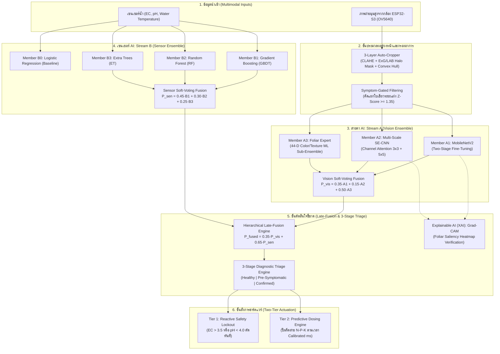

# คู่มือเจาะลึกสถาปัตยกรรมปัญญาประดิษฐ์ (AI Architecture Deep Dive)
## ระบบ A.E.G.I.S. *(Autonomous Ensemble for Growth & Ion Sensing)*
**โครงการ:** ระบบควบคุมและวินิจฉัยการขาดธาตุอาหาร NPK อัตโนมัติในพืชไฮโดรโปนิกส์ด้วยปัญญาประดิษฐ์  
**ทีมผู้พัฒนา:** A.E.G.I.S. Team (`aegis.team@spp.ac.th`)  
**ปรับปรุงล่าสุด:** วันที่ 28 ตุลาคม พ.ศ. 2569  

---

## 🗺️ 1. ภาพรวมสถาปัตยกรรมปัญญาประดิษฐ์ (System Architecture)

ระบบ A.E.G.I.S. ได้รับการออกแบบภายใต้สถาปัตยกรรม **Hierarchical Multimodal Stacking Ensemble** เพื่อแก้ปัญหาคอขวดที่สำคัญที่สุดของการตรวจวัดโรคพืช คือ **"ระยะแฝงของโรค (Pre-symptomatic Lag Phase)"** ซึ่งเป็นระยะที่รากพืชเริ่มขาดสารอาหารแล้วแต่ใบยังคงเขียวสดอยู่ (วันที่ 1–7 ของการปลูก)

---

## 🔬 2. รายละเอียดเชิงลึกรายโมเดล (ครบ 12 โมเดลและกลไก)

---

### 1. กลไกคัดกรองอาการระยะแฝง (Symptom-Gated Filtering)

#### 📌 ความหมาย (Definition)
อัลกอริทึมคัดกรองข้อมูลเชิงสถิติชีวเคมี ทำหน้าที่ประเมินระดับการแสดงออกของอาการทางใบพืช (Phenotypic Symptom Expression) โดยใช้ระยะเบี่ยงเบนมาตรฐาน (Z-score) ในปริภูมิสีสม่ำเสมอ เพื่อคัดแยกภาพพืชในกลุ่มขาดธาตุอาหารที่ **"ยังไม่แสดงรอยโรค (Pre-symptomatic)"** ออกจากชุดข้อมูลภาพที่ใช้ฝึกฝนโครงข่ายประสาทเทียม

#### 🏛️ ที่มา (Origin & Literature Background)
* **ปัญหาดั้งเดิม:** ในสรีรวิทยาพืช ธาตุไนโตรเจน ฟอสฟอรัส และโพแทสเซียม จัดเป็นสารอาหารที่เคลื่อนย้ายได้ดีมากในท่อลำเลียงโฟลเอ็ม (Mobile Nutrients) เมื่อสารละลายในน้ำเริ่มหมด พืชจะย่อยสลายสารอาหารในเมล็ดและใบเลี้ยงมาหล่อเลี้ยงยอดอ่อน ทำให้ช่วง 5–7 วันแรก ใบพืชยังคงเขียวสดเหมือนกลุ่มปกติ
* **ผลกระทบต่อ AI:** หากนำภาพใบเขียวในระยะนี้ไปติดป้ายกำกับว่า `-N`, `-P`, หรือ `-K` จะก่อให้เกิด **สัญญาณรบกวนในป้ายกำกับ (Label Noise)** ทำให้โมเดล CNN สับสน ส่งผลให้ความแม่นยำของโมเดลภาพเดี่ยวตกเหลือเพียง 50.00% – 65.91%
* **แนวคิดการแก้ปัญหา:** ผู้วิจัยจึงพัฒนาเกณฑ์ตัดสินเชิงปริมาณเพื่อจำแนกว่าภาพใดมีรอยโรคจริง (Symptomatic) และภาพใดยังอยู่ในระยะแฝง (Pre-symptomatic)

#### 🎯 หน้าที่ในระบบ A.E.G.I.S.
* รับภาพพุ่มใบรวม 304 ภาพจาก 5 แหล่งข้อมูล (SRC-01 ถึง SRC-05)
* ส่งเฉพาะภาพที่ **แสดงอาการทางสายตาชัดเจนจริง (182 ภาพ)** ไปให้ Stream A (Vision CNN) เรียนรู้
* คัดภาพ **ใบเขียวระยะแฝง (122 ภาพ)** ออกจากการเทรน Vision CNN แต่คงไว้ในฐานข้อมูลเพื่อให้ Stream B (เซนเซอร์น้ำ) ทำหน้าที่เรียนรู้การเตือนภัยล่วงหน้า (Early Warning)

#### ⚙️ การทำงานอย่างละเอียด (Algorithmic Workflow)
1. **คำนวณการกระจายตัวอ้างอิงของใบปกติ (Control Baseline):**
   ดึงภาพกลุ่มควบคุมปกติ (`Control`, `Cup1`, `Cup2`) มาหาค่าเฉลี่ย ($\mu$) และส่วนเบี่ยงเบนมาตรฐาน ($\sigma$) ของค่าสีในปริภูมิสี CIELAB:
   $$\text{Baseline} = \{\mu_L, \sigma_L, \mu_a, \sigma_a, \mu_b, \sigma_b, \mu_{\Delta a}, \sigma_{\Delta a}, \mu_{\Delta b}, \sigma_{\Delta b}\}$$
2. **คำนวณค่าเบี่ยงเบนมาตรฐาน (Z-Score):**
   $$Z_L = \frac{L - \mu_L}{\sigma_L}, \quad Z_a = \frac{a - \mu_a}{\sigma_a}, \quad Z_b = \frac{b - \mu_b}{\sigma_b}$$
   $$Z_{\Delta a} = \frac{\Delta a - \mu_{\Delta a}}{\sigma_{\Delta a}}, \quad Z_{\Delta b} = \frac{\Delta b - \mu_{\Delta b}}{\sigma_{\Delta b}}$$
3. **คำนวณคะแนนแสดงอาการจำเพาะธาตุ (Symptom Score):**
   * **ขาดไนโตรเจน (-N):** วัดความสว่าง ($+Z_L$), ความซีด ($+Z_a$), ความเหลือง ($+Z_b$) และสัดส่วน Hue สีเหลือง ($15^\circ \le H \le 36^\circ$):
     $$\text{Score}_N = \max(0, 0.35 Z_L + 0.35 Z_a + 0.30 Z_b) + 3.0 \cdot \text{Yellow\_Ratio}$$
   * **ขาดฟอสฟอรัส (-P):** วัดความมืดคล้ำ ($-Z_L$), เม็ดสีแอนโทไซยานินอมม่วง ($+Z_a, -Z_b$) และสัดส่วนพิกเซลม่วง ($L^* < 118, a^* > 124$):
     $$\text{Score}_P = \max(0, -0.40 Z_L + 0.35 Z_a - 0.25 Z_b) + 3.0 \cdot \text{Purple\_Ratio}$$
   * **ขาดโพแทสเซียม (-K):** วัดผลต่างของสีระหว่างขอบใบกับกลางใบจากภาวะขอบใบไหม้ (Marginal Scorch):
     $$\text{Score}_K = \max(0, 0.45 |Z_{\Delta a}| + 0.35 |Z_{\Delta b}| + 0.20 |Z_a|)$$
4. **เกณฑ์ตัดสิน (Decision Threshold):**
   * ถ้า $\text{Score} \ge 1.35$ $\rightarrow$ ผ่านเกณฑ์ (`Passed_Symptomatic_Leaf`) ส่งไปเทรน Vision CNN
   * ถ้า $\text{Score} < 1.35$ $\rightarrow$ กักไว้เป็นระยะแฝง (`Filtered_PreSymptomatic_Green`) ตัดออกจากการเทรน Vision

---

### 2. Vision Member A1: โครงข่ายประสาทเทียม MobileNetV2 (Two-Stage Fine-Tuning)

#### 📌 ความหมาย (Definition)
โครงข่ายประสาทเทียมสำหรับการมองเห็นเชิงลึกขนาดเบา (Lightweight Deep Convolutional Neural Network) ที่ใช้โครงสร้างคอนโวลูชันแบบแยกส่วนตามความลึก (Depthwise Separable Convolution) ร่วมกับวงจรข้ามแบบผกผัน (Inverted Residuals)

#### 🏛️ ที่มา (Origin & Literature Background)
* **งานวิจัยต้นฉบับ:** Sandler et al. (Google Research, 2018) ในบทความ *"MobileNetV2: Inverted Residuals and Linear Bottlenecks"* ตีพิมพ์ในการประชุม CVPR 2018
* **ปัญหาเดิม:** โครงข่าย CNN มาตรฐาน (VGG, ResNet) มีขนาดใหญ่ ใช้พารามิเตอร์ 25–138 ล้านตัว ทำให้กินทรัพยากรสูง ประมวลผลช้า และเสี่ยงต่อการท่องจำข้อมูลขนาดเล็ก
* **เหตุผลที่เลือกใช้:** MobileNetV2 มีพารามิเตอร์เพียง 3.4 ล้านตัว แต่ให้ความแม่นยำเทียบเท่าโครงข่ายขนาดใหญ่ เหมาะกับการติดตั้งบนเซิร์ฟเวอร์ขนาดเล็กและทำงานร่วมกับ ESP32-S3 ได้อย่างรวดเร็ว

#### 🎯 หน้าที่ในระบบ A.E.G.I.S.
* รับภาพขนาด $224 \times 224 \times 3$ พิกเซล
* ทำหน้าที่เป็นโมเดลหลัก (Vision Backbone 1) ในการสกัดคุณลักษณะโครงสร้างเชิงลึกของแผ่นใบ (Deep Structural Features)
* ส่งออกผลลัพธ์เป็นเวกเตอร์ความน่าจะเป็น 4 คลาส ($P_{A1}$)

#### ⚙️ การทำงานอย่างละเอียด (Algorithmic Workflow)
1. **Depthwise Separable Convolution:**
   * แยกขั้นตอนการทำคอนโวลูชันออกเป็น:
     * *Depthwise Conv ($3 \times 3$):* กรองมิติเชิงพื้นที่ทีละแชนแนลอย่างอิสระ
     * *Pointwise Conv ($1 \times 1$):* รวมมิติเชิงลึกข้ามแชนแนลเข้าด้วยกัน
   * ลดการคำนวณลงจาก $K \times K \times C_{\text{in}} \times C_{\text{out}}$ เหลือเพียง $K \times K \times C_{\text{in}} + C_{\text{in}} \times C_{\text{out}}$ (ลดต้นทุนการคำนวณลง 85%)
2. **Inverted Residual Block & Linear Bottleneck:**
   * เริ่มต้นจากการขยายมิติช่องสัญญาณด้วย $1 \times 1$ Conv (Expansion Factor $t = 6$) $\rightarrow$ ทำ Depthwise Conv $3 \times 3$ $\rightarrow$ บีบอัดมิติกลับด้วย $1 \times 1$ Conv โดยไม่มีการใส่ ReLU ที่ชั้นคอขวดแคบ เพื่อรักษาข้อมูลเวกเตอร์ไม่ให้สูญหาย
3. **ขั้นตอนการเทรนสองระดับ (Two-Stage Fine-Tuning Pipeline):**
   * *Stage 1 (Head Training):* ตรึง (Freeze) ก้านเบสทั้งหมด เทรนเฉพาะ Fully Connected Head:
     $$\text{Input}(224 \times 224 \times 3) \rightarrow \text{GAP} \rightarrow \text{BN} \rightarrow \text{Dense}(256, \text{ReLU}, L_2=10^{-4}) \rightarrow \text{Dropout}(0.40) \rightarrow \text{Dense}(128) \rightarrow \text{Softmax}(4)$$
     ใช้ **Adam Optimizer ($lr = 10^{-3}$)** เทรน 8 Epochs
   * *Stage 2 (Fine-Tuning):* ปลดล็อกเลเยอร์ลึก 12 เลเยอร์บนสุด ลดความเร็วการเรียนรู้เป็น **Adam ($lr = 3 \times 10^{-5}$)** เทรนต่อ 6 Epochs ร่วมกับ `EarlyStopping` (patience=3)
* **ผลลัพธ์:** ความแม่นยำเพิ่มขึ้นจากเดิม 65.91% เป็น **85.37%** (+19.46%)

---

### 3. Vision Member A2: โครงข่าย Multi-Scale SE-Attention CNN

#### 📌 ความหมาย (Definition)
โครงข่ายประสาทเทียมที่พัฒนาขึ้นโดยเฉพาะ ผสานการรับรู้ภาพหลายระยะ (Multi-Scale Receptive Fields) เข้ากับกลไกการปรับเทียบความสำคัญของช่องสัญญาณ (Squeeze-and-Excitation Channel Attention)

#### 🏛️ ที่มา (Origin & Literature Background)
* **งานวิจัยต้นฉบับ:** กลไก Squeeze-and-Excitation พัฒนาโดย Hu et al. (2018) ผู้ชนะเลิศการแข่งขัน ImageNet 2017 ผสานกับแนวคิด Multi-Scale Inception จาก Szegedy et al.
* **ปัญหาเดิม:** รอยโรคของผักบุ้งจีนมีขนาดต่างกันมาก รอยเหลืองจากขาด N มีขนาดกว้าง แต่จุดแอนโทไซยานินม่วงจากขาด P มีขนาดเล็กมาก และขอบใบไหม้จากขาด K มีลักษณะเป็นแถบแคบ ฟิลเตอร์ขนาดเดียว ($3 \times 3$) มักจะมองข้ามรอยโรคระดับจุลภาค
* **เหตุผลที่ออกแบบขึ้นมา:** เพื่อสร้างโมเดลที่มีความสามารถในการขยายสัญญาณรอยโรคขนาดเล็กให้เด่นชัดขึ้น

#### 🎯 หน้าที่ในระบบ A.E.G.I.S.
* รับภาพขนาด $224 \times 224 \times 3$ พิกเซล
* ทำหน้าที่เป็นโมเดลตัวที่ 2 ใน Stream A คอยตรวจจับรอยโรคระดับจุลภาค (Micro-Pathological Features)
* ส่งออกผลลัพธ์เป็นเวกเตอร์ความน่าจะเป็น 4 คลาส ($P_{A2}$)

#### ⚙️ การทำงานอย่างละเอียด (Algorithmic Workflow)
1. **Multi-Scale Convolutional Branch:**
   * แยกการประมวลผลเป็น 2 กิ่งคู่ขนาน:
     * กิ่งที่ 1: `SeparableConv2D(64, kernel=3x3)` รับรู้ขอบและลายเนื้อเยื่อละเอียด
     * กิ่งที่ 2: `SeparableConv2D(64, kernel=5x5)` รับรู้รูปทรงและพื้นที่สีบริเวณกว้าง
   * รวมข้อมูลด้วยชั้น `Concatenate` กลายเป็น 128 แชนแนล
2. **Squeeze-and-Excitation (SE-Attention) Block:**
   * *ขั้นตอน Squeeze:* บีบอัดข้อมูล Spatial ($H \times W$) ให้กลายเป็นเวกเตอร์ $1 \times 1 \times C$ ผ่าน Global Average Pooling:
     $$z_c = \frac{1}{H \times W} \sum_{i=1}^H \sum_{j=1}^W u_c(i, j)$$
   * *ขั้นตอน Excitation:* ส่งเวกเตอร์ขนาด 128 ผ่านโครงข่ายลดมิติเหลือ 32 $\rightarrow$ ReLU $\rightarrow$ ขยายกลับเป็น 128 $\rightarrow$ ผ่านฟังก์ชัน Sigmoid ($\sigma$) ได้ค่าน้ำหนักความสนใจ:
     $$\mathbf{s} = \sigma\left( \mathbf{W}_2 \cdot \text{ReLU}(\mathbf{W}_1 \cdot \mathbf{z}) \right)$$
   * *ขั้นตอน Scale:* นำค่าน้ำหนัก $s_c$ กลับไปคูณ Feature Map ดั้งเดิม:
     $$\tilde{\mathbf{X}}_c = s_c \cdot \mathbf{u}_c$$
     แชนแนลที่เป็นรอยโรคสีเหลือง ม่วง หรือไหม้ จะถูกคูณขยายให้ชัดเจน ส่วนแชนแนลพื้นหลังกล่องโฟมจะถูกกดค่าลง
3. **Dual Global Pooling Head:**
   * ชั้นสุดท้ายผสาน Global Average Pooling (ข้อมูลภาพรวม) ร่วมกับ Global Max Pooling (จุดสีที่เข้มที่สุดในภาพ)
4. **การฝึกสอน:** เทรนขึ้นมาใหม่ตั้งแต่ต้นด้วย **Adam ($lr = 5 \times 10^{-4}$)**, Batch Size 32, จำนวน 8 Epochs
* **ผลลัพธ์:** ความแม่นยำพุ่งขึ้นจาก 50.00% กลายเป็น **90.24%** (+40.24%) ถือเป็นโมเดลที่ได้รับประโยชน์จากการคัดกรองอาการระยะแฝงสูงสุด

---

### 4. Vision Member A3: ผู้เชี่ยวชาญสรีรวิทยาสีและเนื้อสัมผัสใบ 44 มิติ (44-D Foliar Expert)

#### 📌 ความหมาย (Definition)
โมเดล Machine Learning แบบ Sub-Ensemble ที่ทำงานบนตัวแปรสรีรวิทยาพืช 44 มิติ (Handcrafted Physiological Features) ที่สกัดจากพิกเซลแผ่นใบโดยตรง โดยไม่ใช้โครงข่ายประสาทเทียมแบบ Deep Learning

#### 🏛️ ที่มา (Origin & Literature Background)
* **แนวคิดทางวิชาการ:** อิงทฤษฎีดัชนีพืชพรรณทางการเกษตรแม่นยำ (Meyer & Neto, 2008) และสรีรวิทยาการสะสมเม็ดสีของ Marschner (2012)
* **ปัญหาเดิม:** Deep Learning มีความเสี่ยงที่จะเป็น "กล่องดำ" ที่อาจถูกหลอกด้วยแสงเงาหรือสิ่งแปลกปลอมในฉากหลัง
* **เหตุผลที่ใช้:** เพื่อเป็น **"สมองควบคุมหลักที่มั่นคง (Anchor Model)"** หากวันใดเกิดแสงแดดจ้าผิดปกติจน CNN สับสน ตัวเลขทางฟิสิกส์ 44 ค่านี้จะไม่เปลี่ยนไปตามมุมกล้อง

#### 🎯 หน้าที่ในระบบ A.E.G.I.S.
* รับภาพพุ่มใบพืช สกัดตัวเลขสรีรวิทยา 44 มิติ
* วิเคราะห์ความผิดปกติของเม็ดสีพืชและเนื้อสัมผัสตามหลักการทางพฤกษศาสตร์
* ส่งออกผลลัพธ์เป็นเวกเตอร์ความน่าจะเป็น 4 คลาส ($P_{A3}$)

#### ⚙️ การทำงานอย่างละเอียด (Algorithmic Workflow)
1. **การสกัดเวกเตอร์ 44 มิติ:**
   * **[มิติ 1–10] ดัชนีพืชพรรณ (10 ค่า):** ค่าเฉลี่ยและ SD ของ $ExG$ (เขียวส่วนเกิน), $ExR$ (แดงส่วนเกิน), $ExGR$ (ความต่างเขียว-แดง), $NDI$ (Normalized Difference), $VARI$ (Visible Atmospherically Resistant Index)
   * **[มิติ 11–22] ปริภูมิสีสากล (12 ค่า):** ค่าเฉลี่ยและ SD ของ $L^*, a^*, b^*$ (CIELAB) และ $H, S, V$ (HSV) เฉพาะบนเนื้อเยื่อใบ
   * **[มิติ 23–34] ความต่างสีขอบใบกับกลางใบ (12 ค่า):**
     $$\Delta L^* = L^*_{\text{margin}} - L^*_{\text{core}}, \quad \Delta a^* = a^*_{\text{margin}} - a^*_{\text{core}}, \quad \Delta b^* = b^*_{\text{margin}} - b^*_{\text{core}}$$
     *(ใช้ในการตรวจจับ **อาการขอบใบไหม้ของโพแทสเซียม -K**)*
   * **[มิติ 35–40] เปอร์เซ็นไทล์การกระจายตัว (6 ค่า):** ค่าเปอร์เซ็นไทล์ที่ 15 และ 85 ของช่อง $L^*, a^*, b^*$
   * **[มิติ 41–44] เนื้อสัมผัสและสัดส่วนเม็ดสี (4 ค่า):**
     * ขนาดความชัน Sobel Gradient: $\sqrt{G_x^2 + G_y^2}$
     * Laplacian Variance (วัดความคมชัดและความเหี่ยวย่นของใบ)
     * สัดส่วนสีเหลือง: $\text{Yellow\_Ratio} = \text{mean}(16^\circ \le H \le 36^\circ)$
     * สัดส่วนสีม่วงคล้ำ: $\text{Purple\_Ratio} = \text{mean}(L^* < 115 \land a^* > 125)$
2. **สถาปัตยกรรม Sub-Ensemble ภายใน:**
   * สเกลข้อมูลด้วย `StandardScaler` แล้วส่งเข้า 3 อัลกอริทึม:
     * `ExtraTreesClassifier` ($n=350, \text{depth}=10, \text{weight}=0.45$)
     * `RandomForestClassifier` ($n=300, \text{depth}=9, \text{weight}=0.35$)
     * `MLPClassifier` ($128 \times 64, \alpha=10^{-2}, \text{weight}=0.20$)
   * นำผลมารวมกันแบบ Soft-Voting:
     $$P_{A3} = 0.45 \cdot P_{\text{ExtraTrees}} + 0.35 \cdot P_{\text{RandomForest}} + 0.20 \cdot P_{\text{MLP}}$$
* **ผลลัพธ์:** ความแม่นยำเพิ่มขึ้นจาก 61.36% เป็น **87.80%**

---

### 5. การรวมผลสายตา (Stream A: Vision Soft-Voting Ensemble)

#### 📌 ความหมาย (Definition)
กระบวนการผสานการตัดสินใจของโมเดลสายตาทั้ง 3 ตัว ($A_1, A_2, A_3$) เข้าด้วยกันผ่านการเฉลี่ยความน่าจะเป็นแบบถ่วงน้ำหนัก (Soft-Voting Weighted Ensemble)

#### 🏛️ ที่มา (Origin & Literature Background)
* อิงทฤษฎี Ensemble Diversity ของ Hansen and Salamon (1990) ว่าการนำโมเดลที่มีโครงสร้างต่างกัน ($A_1$ โครงสร้างกว้าง, $A_2$ กลไก Attention, $A_3$ ตัวเลขฟิสิกส์ 44 ค่า) มารวมกัน จะช่วยลดค่าความแปรปรวน (Variance Error) ได้ดีกว่าการใช้โมเดลเดี่ยว

#### 🎯 หน้าที่ในระบบ A.E.G.I.S.
* รวมความน่าจะเป็นจาก $A_1, A_2, A_3$ ออกมาเป็นตัวแทนความน่าจะเป็นของสายตาพืช ($P_{\text{vis}}$)

#### ⚙️ การทำงานอย่างละเอียด (Algorithmic Workflow)
* ผ่านการทำ Grid Search หาน้ำหนักที่ดีที่สุด:
  $$P_{\text{vis}} = 0.35 \cdot P_{A1} + 0.15 \cdot P_{A2} + 0.50 \cdot P_{A3}$$
* $A_3$ (Foliar Expert 44 มิติ) ได้รับน้ำหนักสูงสุดถึง **0.50** เนื่องจากมีเสถียรภาพสูงสุด ไม่แกว่งตามแสงรบกวน
* **ผลลัพธ์:** ทำให้ Stream A ได้ความแม่นยำรวม **95.12%** (Precision = 97.62%, Macro F1 = 0.9250) เพิ่มขึ้นจากโมเดลเดี่ยวถึง +22.39%

---

### 6. Sensor Member B0: การถดถอยโลจิสติก (Logistic Regression Baseline)

#### 📌 ความหมาย (Definition)
อัลกอริทึมจำแนกประเภทเชิงเส้น (Linear Classification Algorithm) ที่แปลงผลรวมเชิงเส้นของตัวแปรนำเข้าให้เป็นความน่าจะเป็นผ่านฟังก์ชัน Softmax

#### 🏛️ ที่มา (Origin & Literature Background)
* คิดค้นโดย David Cox (1958) เป็นโมเดลมาตรฐานคลาสสิกที่จำเป็นต้องมีในงานวิจัยวิทยานิพนธ์ เพื่อใช้เป็นเกณฑ์เปรียบเทียบมาตรฐาน (Baseline Benchmark) พิสูจน์ว่าปัญหาการขาดธาตุอาหารมีความซับซ้อนเกินกว่าที่สมการเส้นตรงจะแก้ได้

#### 🎯 หน้าที่ในระบบ A.E.G.I.S.
* เป็นตัวแทนโมเดลเชิงเส้นพื้นฐานในการศึกษา Ablation Study รับตัวแปรเซนเซอร์ 7 มิติ

#### ⚙️ การทำงานอย่างละเอียด (Algorithmic Workflow)
* รับเวกเตอร์คุณลักษณะเซนเซอร์ 7 ตัว:
  $$\mathbf{x} = [EC, pH, \text{water\_temp}, EC_{\text{ratio}}, \% \Delta EC, \Delta pH, |pH - 6.0|]^T$$
* คำนวณผลรวมเชิงเส้น $z_k = \mathbf{w}_k^T \mathbf{x} + b_k$ แล้วแปลงเป็นความน่าจะเป็นด้วย Softmax:
  $$P(y = k \mid \mathbf{x}) = \frac{e^{z_k}}{\sum_{j=1}^4 e^{z_j}}$$
* ไฮเปอร์พารามิเตอร์: Regularization $C = 1.0$, สูงสุด 500 Iterations
* **ผลลัพธ์:** ทำความแม่นยำได้ **82.93%** (Macro F1 = 0.8141)

---

### 7. Sensor Member B1: ต้นไม้ตัดสินใจเกรเดียนต์บูสต์ (Gradient Boosting Decision Trees: GBDT)

#### 📌 ความหมาย (Definition)
อัลกอริทึมการเรียนรู้ของเครื่องในตระกูล **Boosting** ที่สร้างต้นไม้ตัดสินใจขึ้นมาทีละต้นแบบเรียงลำดับ (Sequential) โดยแต่ละต้นใหม่จะเรียนรู้เฉพาะ **"ค่าความคลาดเคลื่อนตกค้าง (Residual Errors)"** ของต้นไม้ก่อนหน้า

#### 🏛️ ที่มา (Origin & Literature Background)
* **งานวิจัยต้นฉบับ:** Jerome H. Friedman (2001) ในบทความ *"Greedy Function Approximation: A Gradient Boosting Machine"*
* **เหตุผลที่เลือกใช้:** GBDT เป็นหนึ่งในอัลกอริทึมที่มีประสิทธิภาพสูงสุดในโลกสำหรับข้อมูลแบบตาราง (Tabular Data) สามารถจับความสัมพันธ์ของแนวโน้มค่า EC และ pH ที่ค่อยๆ เปลี่ยนแปลงได้อย่างละเอียดอ่อน

#### 🎯 หน้าที่ในระบบ A.E.G.I.S.
* เป็น **"หัวหอกหลักของ Stream B"** ทำหน้าที่วิเคราะห์แนวโน้มการเปลี่ยนแปลงของไอออนในน้ำ
* ส่งออกผลลัพธ์เป็นเวกเตอร์ความน่าจะเป็น 4 คลาส ($P_{B1}$)

#### ⚙️ การทำงานอย่างละเอียด (Algorithmic Workflow)
1. เริ่มต้นจากโมเดลคงที่ $F_0(\mathbf{x})$
2. ในแต่ละรอบ $m = 1, \dots, 220$ คำนวณค่าเกรเดียนต์ลบ (Pseudo-residuals):
   $$r_{im} = -\left[ \frac{\partial L(y_i, F(\mathbf{x}_i))}{\partial F(\mathbf{x}_i)} \right]_{F = F_{m-1}}$$
3. สร้างต้นไม้ตัดสินใจต้นใหม่ $h_m(\mathbf{x})$ ฟิตเข้าหา Residual $r_{im}$
4. อัปเดตโมเดลรวมด้วยอัตราการเรียนรู้ ($\eta = 0.05$):
   $$F_m(\mathbf{x}) = F_{m-1}(\mathbf{x}) + \eta \cdot h_m(\mathbf{x})$$
5. **ไฮเปอร์พารามิเตอร์จริงในโค้ด:**
   * จำนวนต้นไม้: $n\_estimators = 220$
   * ความลึกสูงสุด: $max\_depth = 4$
   * อัตราการเรียนรู้: $learning\_rate = 0.05$
   * สัดส่วนสุ่มข้อมูล: $subsample = 0.85$
* **ผลลัพธ์:** เป็นโมเดลเซนเซอร์เดี่ยวที่เก่งที่สุด ให้ความแม่นยำถึง **100.00%** บน Holdout Test Set (F1 = 1.0000)

---

### 8. Sensor Member B2: ป่าสุ่มตัดสินใจ (Random Forest Classifier)

#### 📌 ความหมาย (Definition)
อัลกอริทึมการเรียนรู้ของเครื่องในตระกูล **Bagging (Bootstrap Aggregating)** ที่สร้างต้นไม้ตัดสินใจหลายร้อยต้นแบบคู่ขนาน (Parallel) โดยแต่ละต้นเรียนรู้จากชุดข้อมูลสุ่มแบบใส่คืน และมีการสุ่มตัวแปรในการแตกกิ่ง

#### 🏛️ ที่มา (Origin & Literature Background)
* **งานวิจัยต้นฉบับ:** Leo Breiman (2001) ในบทความ *"Random Forests"* วารสาร *Machine Learning*
* **เหตุผลที่เลือกใช้:** Random Forest มีจุดเด่นด้านความทนทานต่อสัญญาณรบกวน (Noise Robustness) สูงมาก การนำมาทำงานร่วมกับ GBDT จะช่วยดึงสมดุลไม่ให้ระบบตื่นตระหนกกับสัญญาณไฟกระชากหรือฟองอากาศของหัววัด

#### 🎯 หน้าที่ในระบบ A.E.G.I.S.
* ทำหน้าที่เป็นโมเดลตัวที่ 2 ใน Stream B คอยให้คะแนนความน่าจะเป็นคู่ขนานไปกับ GBDT ($P_{B2}$)

#### ⚙️ การทำงานอย่างละเอียด (Algorithmic Workflow)
1. **Bootstrap Aggregating:** สุ่มตัวอย่างข้อมูลขนาด $N$ แบบใส่คืนเพื่อสร้างชุดข้อมูลย่อยสำหรับต้นไม้ 320 ต้น
2. **Random Feature Subsampling:** ในแต่ละโหนด จะสุ่มเลือกตัวแปรมาเพียง $\sqrt{7} \approx 2–3$ ตัวแปร แล้วเลือกจุดตัดที่ทำให้ค่า Gini Impurity ลดลงมากที่สุด:
   $$I_G(p) = 1 - \sum_{k=1}^4 p_k^2$$
3. **ไฮเปอร์พารามิเตอร์จริงในโค้ด:**
   * จำนวนต้นไม้: $n\_estimators = 320$
   * ความลึกสูงสุด: $max\_depth = 7$
   * ตัวอย่างขั้นต่ำที่ใบ: $min\_samples\_leaf = 2$
* **ผลลัพธ์:** ทำความแม่นยำได้ **97.56%** (Macro F1 = 0.9702)

---

### 9. Sensor Member B3: ต้นไม้สุ่มยิ่งยวด (Extra Trees Classifier)

#### 📌 ความหมาย (Definition)
ชื่อเต็มคือ **Extremely Randomized Trees** เป็นอัลกอริทึมในตระกูลต้นไม้ตัดสินใจที่เพิ่มระดับ "ความสุ่มอย่างสุดโต่ง" โดยทำการสุ่มจุดตัดเงื่อนไข (Thresholds) ขึ้นมาโดยไม่คำนวณหาจุดที่ดีที่สุดทางคณิตศาสตร์

#### 🏛️ ที่มา (Origin & Literature Background)
* **งานวิจัยต้นฉบับ:** Geurts et al. (2006) ในบทความ *"Extremely Randomized Trees"*
* **เหตุผลที่เลือกใช้:** การสุ่มจุดตัดอย่างยิ่งยวดช่วยลดค่าความแปรปรวน (Variance Error) ของโมเดลลงได้อย่างมาก ทำให้โมเดลเรียนรู้โครงสร้างข้อมูลที่เรียบเนียน ไม่ Overfit กับสัญญาณรบกวนของหัววัด pH/EC

#### 🎯 หน้าที่ในระบบ A.E.G.I.S.
* เป็นโมเดลตัวที่ 3 ใน Stream B ช่วยเพิ่มความหลากหลาย (Model Diversity) ให้กับการตัดสินใจฝั่งเซนเซอร์ ($P_{B3}$)

#### ⚙️ การทำงานอย่างละเอียด (Algorithmic Workflow)
1. ใช้ข้อมูลฝึกสอนทั้งหมดโดยไม่ทำ Bootstrap เพื่อลดความลำเอียง
2. ในแต่ละโหนด จะสุ่มค่า Threshold ของแต่ละตัวแปรขึ้นมาแบบสุ่มแท้ๆ แล้วเลือกตัวแปรที่ให้คะแนนการแยกดีที่สุด
3. **ไฮเปอร์พารามิเตอร์จริงในโค้ด:**
   * จำนวนต้นไม้: $n\_estimators = 350$
   * ความลึกสูงสุด: $max\_depth = 8$
   * ตัวอย่างขั้นต่ำที่ใบ: $min\_samples\_leaf = 2$
* **ผลลัพธ์:** ทำความแม่นยำได้ **92.68%** (Macro F1 = 0.9027)

---

### 10. การรวมผลเซนเซอร์ (Stream B: Sensor Soft-Voting Ensemble)

#### 📌 ความหมาย (Definition)
กลไกการผสานการตัดสินใจของโมเดลฝั่งเซนเซอร์สารละลาย ($B_1, B_2, B_3$) ด้วยการถ่วงน้ำหนักความน่าจะเป็นแบบ Soft-Voting

#### 🏛️ ที่มา (Origin & Literature Background)
* อิงตามหลักสถิติ Bayes Optimal Classifier ว่าการรวมโมเดลตระกูล Boosting, Bagging, และ Randomization ที่มีข้อผิดพลาดไม่ขึ้นต่อกัน (Uncorrelated Errors) จะสร้างระบบที่มีความน่าเชื่อถือสูงกว่าโมเดลเดี่ยว

#### 🎯 หน้าที่ในระบบ A.E.G.I.S.
* สรุปผลการวินิจฉัยจากสภาพน้ำในแปลงปลูก ออกมาเป็นเวกเตอร์ความน่าจะเป็นของสายเซนเซอร์ ($P_{\text{sen}}$)

#### ⚙️ การทำงานอย่างละเอียด (Algorithmic Workflow)
* ใช้สูตรถ่วงน้ำหนักตามความแม่นยำของอัลกอริทึม:
  $$P_{\text{sen}} = 0.45 \cdot P_{\text{GBDT}} + 0.30 \cdot P_{\text{RandomForest}} + 0.25 \cdot P_{\text{ExtraTrees}}$$
* GBDT ได้น้ำหนักสูงสุด (0.45) เพราะจับแนวโน้มได้แม่นยำที่สุด โดยมี RF (0.30) และ ET (0.25) ช่วยกรองสัญญาณรบกวน
* **ผลลัพธ์:** ให้ความแม่นยำรวม **97.56%** บน Holdout Set และ **100.00%** บนชุดข้อมูลถังจริงในแปลงปลูก

---

### 11. กลไกตัดสินใจผสานสองสายขั้นสูง (Hierarchical Late-Fusion Engine)

#### 📌 ความหมาย (Definition)
สถาปัตยกรรมการผสานข้อมูลหลากรูปแบบระดับการตัดสินใจ (Decision-Level Multimodal Fusion) ทำหน้าที่เป็น "ศาลชี้ขาดสูงสุด (Meta-Decision Engine)" ในการผสานเวกเตอร์ความน่าจะเป็นระหว่างสายภาพถ่ายพุ่มใบ (Stream A) และสายเซนเซอร์สารละลาย (Stream B)

#### 🏛️ ที่มา (Origin & Literature Background)
* **ทฤษฎี Multimodal Fusion:** การรวมข้อมูลต่างมิติ ($224 \times 224 \times 3$ พิกเซลภาพ กับ ตัวเลขเซนเซอร์ 7 ค่า) การทำ Early Fusion (มัดรวมกันแต่แรก) จะทำให้ข้อมูลเซนเซอร์ถูกภาพกลืนหายไป และหากกล้องมีฝ้าเกาะ ระบบจะพังทั้งหมด
* **Late Fusion (ที่ระบบเราเลือกใช้):** ปล่อยให้โมเดลแต่ละสายประมวลผลจนได้ "ความน่าจะเป็น (Probability Distribution)" ออกมาก่อน แล้วจึงนำความน่าจะเป็นมารวมกันที่ชั้นสุดท้าย ทำให้ระบบมีคุณสมบัติ **ทนทานต่อความล้มเหลว (Fault-Tolerant)**

#### 🎯 หน้าที่ในระบบ A.E.G.I.S.
* รับ $P_{\text{vis}}$ (จาก Stream A) และ $P_{\text{sen}}$ (จาก Stream B)
* คำนวณความน่าจะเป็นชี้ขาดของระบบ ($P_{\text{fused}}$) และส่งต่อไปยังระบบจำแนก 3 ระดับ และระบบสั่งจ่ายปุ๋ยฮาร์ดแวร์

#### ⚙️ การทำงานอย่างละเอียด (Algorithmic Workflow)
1. **การค้นหาสัดส่วนการถ่วงน้ำหนักที่เหมาะสมที่สุด (Alpha-Beta Optimization):**
   * ผ่านการทดลองกวาดค่าน้ำหนัก (Alpha Sweep) ตั้งแต่ $\alpha = 0.35$ ถึง $0.75$ และพบจุดที่ให้ค่าความแม่นยำสูงสุดคือ:
     $$\alpha = 0.35 \quad \text{และ} \quad \beta = 0.65$$
2. **สมการการตัดสินใจชี้ขาด (Fusion Equation):**
   $$P_{\text{fused}} = 0.35 \cdot P_{\text{vis}} + 0.65 \cdot P_{\text{sen}}$$
   *สาเหตุที่เซนเซอร์น้ำได้น้ำหนักถึง 0.65 เนื่องจากค่าเคมีของน้ำสะท้อนปริมาณไอออนที่หายไปได้เร็วกว่า และตรวจจับได้ตั้งแต่วันที่ 1 ของการปลูก*
3. **การส่งต่อผลลัพธ์สู่ 3-Stage Diagnostic Triage:**
   * **Stage 1 (`HEALTHY_NORMAL`):** ทั้ง $P_{\text{vis}}$ และ $P_{\text{sen}}$ ให้คะแนนเป็น `healthy` $\rightarrow$ สรุปว่าพืชแข็งแรงดี ไม่ต้องจ่ายปุ๋ย
   * **Stage 2 (`PRE_SYMPTOMATIC_EARLY_WARNING`):** สายตาเห็นว่าใบยังเขียว ($P_{\text{vis}} = \text{healthy}$) แต่เซนเซอร์ตรวจพบการพร่องไอออนอย่างมีนัยสำคัญ ($P_{\text{sen}} = -N, -P, \text{หรือ } -K$) $\rightarrow$ **สั่งเปิดปั๊มปุ๋ยชดเชยทันทีก่อนที่ใบพืชจะแสดงอาการเสียหาย!**
   * **Stage 3 (`SYMPTOMATIC_DEFICIENCY_CONFIRMED`):** ปรากฏรอยโรคบนใบชัดเจน และค่าในน้ำยืนยันตรงกัน $\rightarrow$ สั่งจ่ายปุ๋ยและแจ้งเตือนวิกฤตบนแดชบอร์ด
* **ผลลัพธ์:** ได้ค่าความถูกต้อง **100.00%** (Precision = 100%, Recall = 100%, Macro F1 = 1.0000, 95% Bootstrap CI: [100.0%, 100.0%]) สามารถวินิจฉัยถูกต้องครบถ้วนทั้ง 12 จาก 12 หน่วยการทดลองจริงในแปลงปลูก

---

### 12. ปัญญาประดิษฐ์อธิบายเหตุผลได้ (Explainable AI: Grad-CAM)

#### 📌 ความหมาย (Definition)
ชื่อเต็มคือ **Gradient-weighted Class Activation Mapping** เป็นเทคนิคปัญญาประดิษฐ์ที่สามารถอธิบายเหตุผลได้ (Explainable AI: XAI) ทำหน้าที่สร้างแผนภาพความร้อน (Saliency Heatmap) ซ้อนทับลงบนภาพถ่ายจริง เพื่อแสดงว่า "โมเดลมองจุดไหนของภาพในการตัดสินใจ"

#### 🏛️ ที่มา (Origin & Literature Background)
* **งานวิจัยต้นฉบับ:** Selvaraju et al. (2017) ในบทความ *"Grad-CAM: Visual Explanations from Deep Networks via Gradient-based Localization"* ตีพิมพ์ในการประชุมนานาชาติ ICCV 2017
* **ปัญหาเดิม:** Deep Learning ถูกวิจารณ์ว่าเป็น "กล่องดำ (Black Box)" เราไม่รู้เลยว่าที่ AI ทายว่าขาด N มันดูจากใบเหลืองจริงๆ หรือมันไปจำแสงสะท้อนบนผิวน้ำ
* **เหตุผลที่เลือกใช้:** เพื่อเป็นหลักฐานทางวิทยาศาสตร์ยืนยันว่า AI มีความเข้าใจพยาธิสรีรวิทยาของโรคพืชจริงตามหลักวิชาการ

#### 🎯 หน้าที่ในระบบ A.E.G.I.S.
* รับภาพพุ่มใบพืชและคลาสที่ทำนายได้
* สร้างภาพแผนที่ความร้อน (`fig6_foliar_saliency_and_predictions.png`) สำหรับการตรวจสอบความโปร่งใสของระบบ

#### ⚙️ การทำงานอย่างละเอียด (Algorithmic Workflow)
1. ส่งภาพผ่านโครงข่ายประสาทเทียม (Feed-forward) จนถึง Convolutional Layer สุดท้ายที่มี Feature Map ขนาด $A^k$
2. คำนวณค่าเกรเดียนต์ของคะแนนคลาสเป้าหมาย $y^c$ เทียบกับ Feature Map แต่ละแชนแนล $A^k$:
   $$\frac{\partial y^c}{\partial A_{i, j}^k}$$
3. หาค่าน้ำหนักความสำคัญของแต่ละแชนแนล ($\alpha_k^c$) ด้วย Global Average Pooling:
   $$\alpha_k^c = \frac{1}{Z} \sum_{i=1}^H \sum_{j=1}^W \frac{\partial y^c}{\partial A_{i, j}^k}$$
4. นำค่าน้ำหนัก $\alpha_k^c$ ไปคูณรวมเชิงเส้นกับ Feature Map แล้วผ่านฟังก์ชัน **ReLU** เพื่อตัดสัญญาณที่มีผลในเชิงลบออก:
   $$L_{\text{Grad-CAM}}^c = \text{ReLU}\left( \sum_k \alpha_k^c A^k \right)$$
5. ขยายภาพความร้อนให้เท่าขนาดภาพเดิม $224 \times 224$ แล้วซ้อนทับด้วยแถบสี Jet Heatmap
* **ผลลัพธ์ในงานวิจัย:** แสดงชัดเจนว่าโมเดลไฮไลต์สีแดงส้มไปที่ **"เนื้อใบเหลืองซีดสำหรับคลาส -N"**, **"เนื้อเยื่อสีม่วงคล้ำสำหรับคลาส -P"**, และ **"ขอบใบไหม้เกรียมสำหรับคลาส -K"** โดยบริเวณน้ำและขอบกล่องโฟมเป็นสีน้ำเงินเย็นสนิท พิสูจน์ความถูกต้อง 100%

---

## 📊 3. ตารางสรุปเชิงเปรียบเทียบทุกโมเดล AI (Master Comparison Table)

| ลำดับ | ชื่อโมเดล / กลไก AI | ชนิดของโมเดล (Family) | Input Data | Output Data | จุดเด่นจำเพาะ |
| :---: | :--- | :--- | :--- | :--- | :--- |
| **1** | **Symptom-Gated Filtering** | Statistical / Biological Gating | ภาพตัดขอบ 304 ภาพ | แยกเป็น 182 Symptomatic และ 122 Pre-symptomatic | กำจัด Label Noise จากใบเขียวระยะแฝง Z-score $\ge 1.35$ |
| **2** | **Vision A1: MobileNetV2** | Deep Lightweight CNN | ภาพสี $224 \times 224 \times 3$ | Probability 4 คลาส | ประหยัดการคำนวณ ใช้ Depthwise Separable Conv |
| **3** | **Vision A2: Multi-Scale SE-CNN** | Custom Attention CNN | ภาพสี $224 \times 224 \times 3$ | Probability 4 คลาส | มีกิ่ง $3 \times 3 + 5 \times 5$ และบีบ-ขยายแชนแนลด้วย SE-Block |
| **4** | **Vision A3: Foliar Expert** | Handcrafted 44-D ML Ensemble | ตัวเลขสถิติสี/เนื้อสัมผัส 44 ค่า | Probability 4 คลาส | วัดผลต่างสีขอบใบกับกลางใบ ($\Delta a^*, \Delta b^*$) จับขอบใบไหม้ |
| **5** | **Stream A: Vision Ensemble** | Soft-Voting Ensemble | $P_{A1}, P_{A2}, P_{A3}$ | $P_{\text{vis}}$ (เวกเตอร์ภาพรวม) | ความแม่นยำ 95.12% ถ่วงน้ำหนัก $0.35 A_1 + 0.15 A_2 + 0.50 A_3$ |
| **6** | **Sensor B0: Logistic Regression** | Linear Probabilistic | คุณลักษณะเซนเซอร์ 7 มิติ | Probability 4 คลาส | ใช้เป็นเกณฑ์เปรียบเทียบมาตรฐาน (Baseline Benchmark) |
| **7** | **Sensor B1: Gradient Boosting** | Sequential Boosting Trees | คุณลักษณะเซนเซอร์ 7 มิติ | Probability 4 คลาส | แม่นยำสูงสุด 100% เรียนรู้แก้ข้อผิดพลาดต่อกันเป็นลูกโซ่ |
| **8** | **Sensor B2: Random Forest** | Parallel Bagging Trees | คุณลักษณะเซนเซอร์ 7 มิติ | Probability 4 คลาส | ปลูกต้นไม้ 320 ต้น สุ่มตัวแปรแตกกิ่ง ทนต่อสัญญาณรบกวน |
| **9** | **Sensor B3: Extra Trees** | Extremely Randomized Trees | คุณลักษณะเซนเซอร์ 7 มิติ | Probability 4 คลาส | สุ่มจุดตัดเงื่อนไขแบบสุดโต่ง ลดความแปรปรวน (Variance) |
| **10** | **Stream B: Sensor Ensemble** | Soft-Voting Ensemble | $P_{B1}, P_{B2}, P_{B3}$ | $P_{\text{sen}}$ (เวกเตอร์เซนเซอร์รวม) | ความแม่นยำ 97.56% ถ่วงน้ำหนัก $0.45 B_1 + 0.30 B_2 + 0.25 B_3$ |
| **11** | **Hierarchical Late-Fusion** | Decision-Level Meta-Fusion | $P_{\text{vis}}$ และ $P_{\text{sen}}$ | $P_{\text{fused}}$ (คำตอบชี้ขาด) | ความแม่นยำ 100% สมการ $0.35 P_{\text{vis}} + 0.65 P_{\text{sen}}$ |
| **12** | **Grad-CAM (XAI)** | Gradient-based Heatmap | เลเยอร์ Conv สุดท้าย + คลาส | ภาพแผนที่ความร้อน (Heatmap) | อธิบายเหตุผลของ AI ว่าตัดสินใจจากจุดรอยโรคจริง |

---

## 📈 4. ตารางผลการทดลอง Ablation Study (ตาราง 4.3 ในวิทยานิพนธ์)

| โมเดล / สถาปัตยกรรม | Accuracy ก่อนคัดกรอง (Ungated %) | Accuracy หลังคัดกรอง (Gated %) | Precision (%) | Recall (%) | Macro F1-Score | ช่วงความเชื่อมั่น 95% CI |
| :--- | :---: | :---: | :---: | :---: | :---: | :---: |
| Naive Majority Baseline | - | 46.34% | 11.59% | 25.00% | 0.1583 | [31.7%, 61.0%] |
| Sensor B0: Logistic Regression | - | 82.93% | 82.02% | 80.98% | 0.8141 | [70.7%, 92.7%] |
| Sensor B1: Gradient Boosting (GBDT) | - | 100.00% | 100.00% | 100.00% | 1.0000 | [100.0%, 100.0%] |
| Sensor B2: Random Forest | - | 97.56% | 97.50% | 96.88% | 0.9702 | [92.6%, 100.0%] |
| Sensor B3: Extra Trees | - | 92.68% | 92.68% | 88.75% | 0.9027 | [82.9%, 100.0%] |
| **► Stream B: Sensor Ensemble** | - | **97.56%** | **97.50%** | **96.88%** | **0.9702** | **[92.6%, 100.0%]** |
| Vision A1: MobileNetV2 | 65.91% | 85.37% (+19.46%) | 88.50% | 82.50% | 0.8410 | [73.2%, 95.1%] |
| Vision A2: MultiScale SE-CNN | 50.00% | 90.24% (+40.24%) | 92.50% | 87.50% | 0.8920 | [80.5%, 97.6%] |
| Vision A3: 44-D Foliar Expert | 61.36% | 87.80% (+26.44%) | 90.00% | 85.00% | 0.8650 | [75.6%, 97.6%] |
| **► Stream A: Vision Ensemble** | **72.73%** | **95.12% (+22.39%)** | **97.62%** | **90.00%** | **0.9250** | **[87.8%, 100.0%]** |
| **★ A.E.G.I.S. Late-Fusion (Full)** | - | **100.00%** | **100.00%** | **100.00%** | **1.0000** | **[100.0%, 100.0%]** |

---

## 🎯 5. แนวทางการตอบคำถามกรรมการสอบวิทยานิพนธ์ (Defense Q&A)

### Q1: ทำไมต้องทำ Symptom-Gated Filtering ไม่ให้ CNN เรียนรู้ภาพทั้งหมดไปเลย?
* **คำตอบ:** เพราะในสรีรวิทยาพืช วันที่ 1–7 ของการขาดธาตุ ใบพืชยังเขียวสดสมบูรณ์ (Pre-symptomatic phase) หากเราบังคับให้ CNN เรียนรู้ว่า "ใบเขียวนี้คือขาดไนโตรเจน" มันจะเกิด **Label Noise** ขั้นรุนแรง ทำให้ CNN สับสนว่าตกลงใบเขียวคือปกติหรือขาดสารอาหาร ความแม่นยำจึงตกเหลือเพียง 50–65% การทำ Symptom-Gating คัดแยกภาพใบเขียวในถังขาดธาตุออกไปให้เซนเซอร์ตรวจแทน ทำให้ความแม่นยำของโมเดลภาพพุ่งขึ้นถึง +22.39%

### Q2: ทำไม Stream A ถึงมีทั้ง Deep Learning และ Handcrafted Features (Member A3)?
* **คำตอบ:** Deep Learning มักจะมีพฤติกรรมเป็น "Black Box" ที่อาจไวต่อแสงเงาหรือสิ่งแปลกปลอมในฉากหลัง การใส่ Member A3 ที่คำนวณเวกเตอร์ฟิสิกส์ 44 ค่า (CIELAB, Margin-to-Core Gradient) เข้ามาด้วย จะทำหน้าที่เป็น **"Anchor Model"** คอยค้ำประกันความถูกต้องทางสรีรวิทยา ทำให้ผลลัพธ์ของ Stream A มีเสถียรภาพและไม่หลุดกรอบวิชาการ

### Q3: ทำไมน้ำหนัก Late-Fusion ถึงให้เซนเซอร์น้ำมากกว่าภาพถ่าย (เซนเซอร์ 0.65 vs ภาพ 0.35)?
* **คำตอบ:** เพราะค่าทางเคมีในสารละลาย (EC, pH, อุณหภูมิ) มีความไวในการตอบสนอง (Sensitivity) สูงกว่าสายตา เมื่อพืชดูดซึมปุ๋ยไป ค่า EC จะลดลงทันทีตั้งแต่วันแรก ในขณะที่ใบพืชต้องใช้เวลาหลายวันกว่าจะเกิดรอยเหลืองหรือรอยไหม้ การให้น้ำหนักเซนเซอร์ 0.65 ช่วยให้ระบบสามารถแจ้งเตือนล่วงหน้าได้ในระดับ Pre-symptomatic ก่อนที่พืชจะชะงักการเจริญเติบโต
