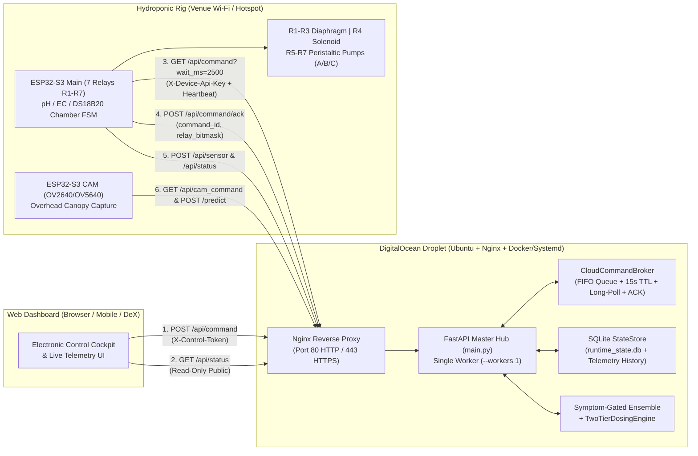

# A.E.G.I.S. DigitalOcean Cloud Backend & End-to-End Pump Control Design Spec

**Date:** 2026-11-05  
**Scope:** End-to-End Cloud Architecture from Web Dashboard $\rightarrow$ DigitalOcean Droplet Backend (`main.py`, `cloud_broker.py`, `state_store.py`) $\rightarrow$ ESP32-S3 Main (7-Relay & Fluidic Chamber FSM) & ESP32-S3 CAM.

---

## 1. Problem Statement & Motivation

Currently, the A.E.G.I.S. backend (`main.py`) and firmware (`firmware/esp32_main/config.h`, `firmware/esp32_cam/config.h`) are designed for a closed local LAN (`192.168.1.22:8000`) with single-laptop execution:
1. **Fragile Single-Slot Command State:** `main.py` stores pending hardware commands in a single global variable `current_command` and immediately resets it to `"IDLE"` on the first `GET /api/command`. Over public internet (DigitalOcean $\leftrightarrow$ Venue Wi-Fi/Hotspot), rapid button presses overwrite each other, dropped HTTP responses lose commands permanently, and the Dashboard has no confirmation (`ACK`) whether the ESP32 actually received and triggered the pump.
2. **No Stale-Command Protection (TTL Fail-Safe):** If the ESP32 loses Wi-Fi during a presentation while a user clicks pump buttons on the Dashboard, a naive queue would fire those stale pump commands minutes later when Wi-Fi reconnects—risking fertilizer overdose or overflow.
3. **No Public Cloud Security:** All actuation endpoints (`/api/command`, `/api/cam_command`, `/api/schedule`, `/api/calibration`) lack authentication. On a public DigitalOcean IP, internet scanners or spectators opening the Dashboard QR code could trigger physical relays.
4. **Volatile In-Memory State & TensorFlow RAM Pressure:** All state (`current_hardware_status`, `command_log`, telemetry history) is lost on process restart, and running multiple Uvicorn workers would duplicate the ~1.2 GB TensorFlow Symptom-Gated Ensemble in RAM, causing Out-Of-Memory (OOM) crashes on a DigitalOcean Droplet.

---

## 2. Chosen Architecture & Design Decisions (Resolved via `/grill-me`)

### 2.1 Full Cloud Hub on a Single DigitalOcean Droplet
- Host the entire stack (**Web Dashboard + FastAPI Backend + Symptom-Gated AI Ensemble + Two-Tier Dosing Engine + SQLite State Store**) on a single DigitalOcean Droplet (Ubuntu 22.04/24.04, 2 GB+ RAM + 2 GB Swapfile).
- Enforce `--workers 1` (single Uvicorn worker with async event loop) so TensorFlow/Keras + LightGBM models load once in memory and share state deterministically.
- Place **Nginx Reverse Proxy** in front on Port `80` / `443`:
  - **ESP32-S3 Main & ESP32-S3 CAM** communicate over HTTP Port `80` (`http://<DO_HOST>/api/...` and `http://<DO_HOST>/predict`) for low-latency microcontroller requests without TLS handshake overhead.
  - **Web Dashboard users** connect via Port `80`/`443` with full static asset caching and `client_max_body_size 10M` for UXGA leaf images.



### 2.2 Reliable HTTP Polling + FIFO Command Queue + ACK & Heartbeat (`server/cloud_broker.py`)
- **FIFO Command Queue with Unique `command_id`:**
  - Every `POST /api/command` creates a queued command entry:
    ```json
    {
      "command_id": "cmd_1730800000_0001",
      "command": "MANUAL_RELAY",
      "relay": 5,
      "duration_ms": 4500,
      "preserve_schedule": true,
      "status": "QUEUED",
      "created_at": "2026-11-05T18:00:00",
      "expires_at_epoch": 1730800015.0,
      "ttl_sec": 15.0
    }
    ```
  - **Command TTL Auto-Expiry (15 Seconds):** Before dispatching any command on `GET /api/command`, `CloudCommandBroker.purge_expired()` marks any command older than `ttl_sec` (default `15.0s`) as `"EXPIRED"` and appends a `"COMMAND_EXPIRED"` entry to `command_log`. Stale pump commands never fire after an internet drop.
  - **High-Priority Emergency `STOP` / `CANCEL_OVERRIDE`:** When `command in ("STOP", "CANCEL_OVERRIDE", "RESUME_AUTO")` arrives, all currently `QUEUED` actuation commands are immediately marked `"CANCELLED"` and the `STOP` command is placed at the head of the queue.
  - **Optional Long-Polling (`GET /api/command?wait_ms=0..5000`):**
    - Default `wait_ms=0` returns immediately (preserving 100% compatibility with existing synchronous tests and firmware).
    - When `wait_ms > 0` (e.g., `2500` ms from ESP32 over DigitalOcean), the async endpoint waits on an `asyncio.Event` for up to `wait_ms` milliseconds and wakes up within `< 50 ms` as soon as the Dashboard posts a command.
  - **Explicit Command ACK (`POST /api/command/ack`):**
    - ESP32 sends `{"command_id": "...", "device_id": "esp32-s3-demo-box-01", "status": "ACKED", "active_relays": [5], "rssi_dbm": -62}`.
    - Updates `current_hardware_status["cloud_link"]["last_ack"]` and marks the command `"ACKED"` in `command_log`.
  - **Real-Time Device Heartbeat & Online Status (`cloud_link` in `/api/status`):**
    - Tracks `esp32_main` (`online: bool`, `last_seen_sec_ago: float`, `rssi_dbm: int`, `pending_queue_size: int`, `last_ack_command_id: str`) and `esp32_cam` (`online: bool`, `last_seen_sec_ago: float`).
    - Heartbeat timeout threshold: `5.0s` for `esp32_main` (polls every 1.5s) and `15.0s` for `esp32_cam`.

### 2.3 Two-Tier Security Model (Public Read-Only Dashboard + Token-Protected Actuation)
- **Read-Only Endpoints (`GET /`, `GET /dashboard`, `GET /api/status`, `GET /api/telemetry/history`, `GET /health`):**
  - Open to any browser so judges/spectators can view the live dashboard without login barriers.
- **Control & Device Authentication (`server/security.py` or inside `server/cloud_broker.py`):**
  - Configured via environment variables:
    - `AEGIS_REQUIRE_AUTH`: `"0"` (default in local dev/unit tests) or `"1"` (production on DigitalOcean).
    - `AEGIS_CONTROL_TOKEN`: PIN/Token for Dashboard pump actuation (e.g., `"aegis-demo-2026"`), passed via header `X-Control-Token` or payload `control_token`.
    - `AEGIS_DEVICE_API_KEY`: Secret key for ESP32 boards (`X-Device-Api-Key` header).
  - Dashboard UI (`server/static/index.html`) includes a compact **Cloud Connection & Control PIN Pill** in the Electronic Control Cockpit so the presenter can unlock pump control once (saved in `localStorage`) and see live `ESP32-MAIN: ONLINE / OFFLINE` + `QUEUE / ACK` status.

### 2.4 SQLite State & Telemetry Persistence (`server/state_store.py`)
- Uses Python's built-in `sqlite3` (`server/runtime_state.db`) with zero extra external DB dependencies:
  1. `kv_state` table: Stores JSON snapshot of `current_hardware_status` (`ec`, `ph`, `temp`, `phase`, `phase_id`, `deficiency_class`, `stage`, `schedule`, `override`, `command_log`) on every state mutation and restores it on FastAPI startup.
  2. `telemetry_history` table: Appends a row (`timestamp`, `device_id`, `ec`, `ph`, `temp`, `deficiency_class`, `stage`, `pump1_ms`, `pump2_ms`, `pump3_ms`) on every `/api/sensor` or `/predict` call (retaining the latest 1,000 records).
  3. Exposes `GET /api/telemetry/history?limit=50` so the Dashboard can inspect historical readings across server restarts.

---

## 3. Unified Scope with Electronic Control Cockpit Overhaul

To ensure the Dashboard and Backend work together seamlessly from UI button click $\rightarrow$ DigitalOcean $\rightarrow$ Physical Pump Relay:
1. **8-Phase Preservation FSM Sync (`Phase 0`..`Phase 7`):** Synchronize `PHASE_LABELS` in `main.py`, `JUMP_PHASE` in `esp32_main.ino`, and the 8-Phase Stepper + Interactive Chamber Schematic in `server/static/index.html`.
2. **Cloud Command Broker, Auth & State Store (`server/cloud_broker.py`, `server/state_store.py`, `main.py`):** FIFO command queue, 15s TTL expiry, `POST /api/command/ack`, heartbeat tracking, optional token enforcement, and SQLite state persistence.
3. **ESP32-Main & ESP32-CAM Cloud Firmware Upgrade (`firmware/esp32_main/`, `firmware/esp32_cam/`):** Add DigitalOcean host configuration, `X-Device-Api-Key` headers, `command_id` parsing, `POST /api/command/ack`, and Wi-Fi auto-reconnect with local hardware relay watchdog.
4. **Electronic Control Cockpit UI + Cloud Link Status (`server/static/index.html`):** Top Cockpit (`<InteractiveChamberSchematic />` + 8-Phase Stepper + Cloud Link/ACK Status Badge + Control PIN modal) + Segmented Sub-Tab Workspace (Pumps & Per-Pump Flow Dosing | ESP32-CAM Studio | Simulator & Log | Hardware Pinout).
5. **DigitalOcean Deployment Bundle (`deploy/digitalocean/`):** `Dockerfile`, `docker-compose.digitalocean.yml`, `nginx.conf`, `.env.example`, and `setup_droplet.sh` (with 2 GB Swap setup).
